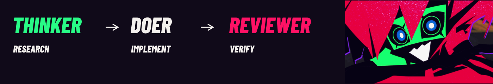

Three native Codex sessions for research, scoped implementation and independent review, with checkpoints that bind source and instructions.

[Workflow](#workflow) · [Quickstart](#quickstart) · [Current limits](docs/STATUS.md) · [Architecture](ARCHITECTURE.md) · [Contribute](CONTRIBUTING.md) · [Credits](docs/ASSETS.md) · [Static view](docs/README_STATIC.md)

## Workflow



The **Thinker** researches and scopes the task. The **Doer** works within its permitted candidate. A fresh **Reviewer** independently checks the sealed result and evidence. You review the report and make the final source-bound decision.

The selected profile requests `gpt-6.1-sol` for all three roles, with medium Thinker/Doer and high Reviewer effort. One owner controls writes. Stale inputs or uncertain effects hold work for reconciliation. Completed formal outcomes stop at `AWAITING_HUMAN`; no successor task follows automatically. The graphic illustrates these roles and does not certify execution. [Native profile](NATIVE_PROFILE.md).

## Quickstart

From a checkout of this branch, start with offline inspection. Requires Linux x86_64, Python 3.11+ with pip/venv, bubblewrap and working user, mount, PID and network namespaces.

```sh
python3 -m venv .venv
. .venv/bin/activate
python -m pip install --require-hashes -r requirements.lock
PYTHONDONTWRITEBYTECODE=1 python -m unittest discover -s controller/tests -v
```

Tests use disposable fixtures and do not call models or need authentication. A failed isolation prerequisite remains a failure. [Setup and collector diagnostics](docs/QUICKSTART.md) · [Host requirements](ENVIRONMENT.md).

Native use additionally needs the qualified Codex CLI 0.163.0/profile, existing authentication and tmux for ordinary panes. Read the preserved [implementation guide](IMPLEMENTATION_README.md#native-startup) before configuring an isolated fixture. No runtime is launched by this presentation.

## Current limits

Experimental. Current-source native startup/lifecycle/recovery qualification, the separate v2 comparison and final independent review remain pending at the recorded source cutoff. Recent-request footprint, cumulative usage and unknown exact context occupancy are distinct. See [client support](CLIENT_SUPPORT.md), [evaluation](EVALUATION.md) and [current status](docs/STATUS.md).

No source-bound product demo was available for this candidate. The banner is actual character footage, not a controller recording. Code-license selection and public character-art redistribution remain unresolved. This private presentation candidate awaits Mani’s visual review.

## Credits

Project by **Mani Marami Milani**. Inspired by Capri from *Cyberpunk: Edgerunners 2*; unofficial and unaffiliated with CD PROJEKT RED, TRIGGER or Netflix. The hero uses BluRei’s source 19; the workflow uses emdzejus’s source 12. Barlow Condensed is used under its bundled OFL notice. [Sources, edits and reuse status](docs/ASSETS.md).
