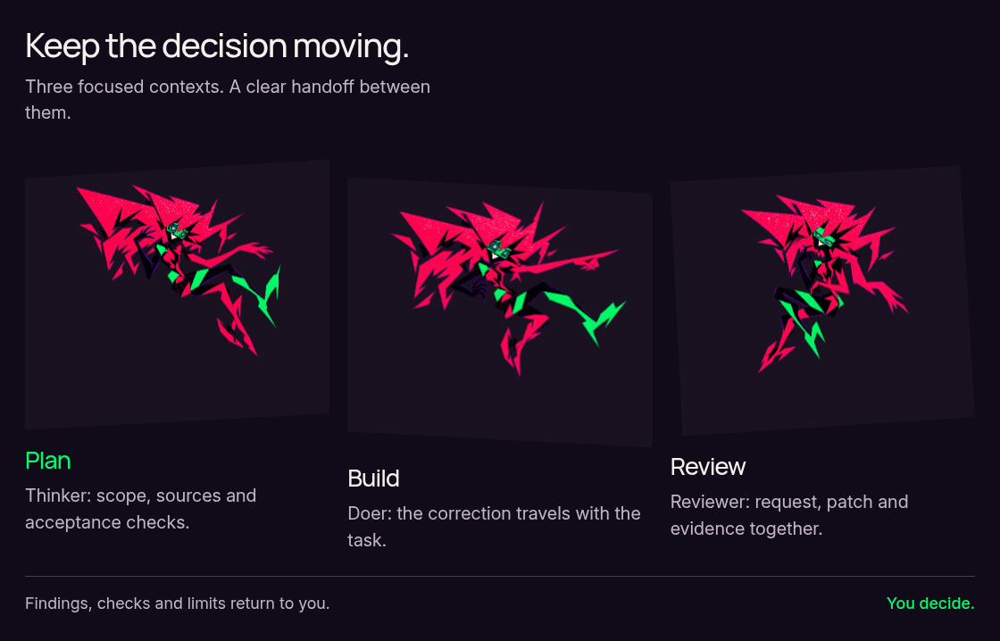
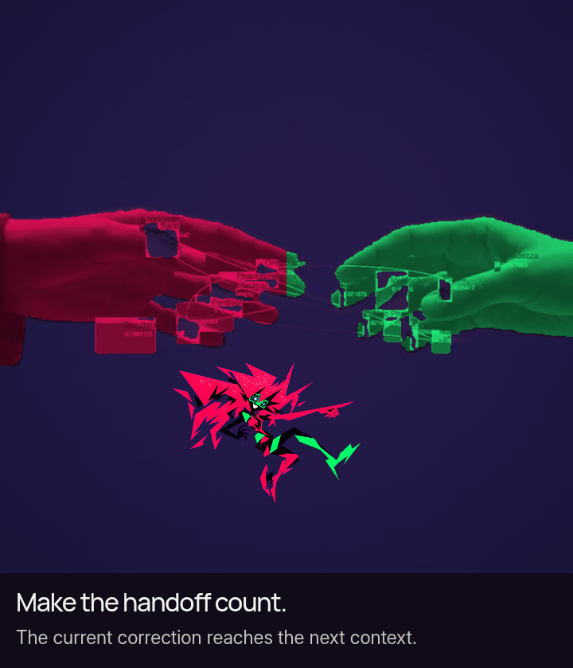
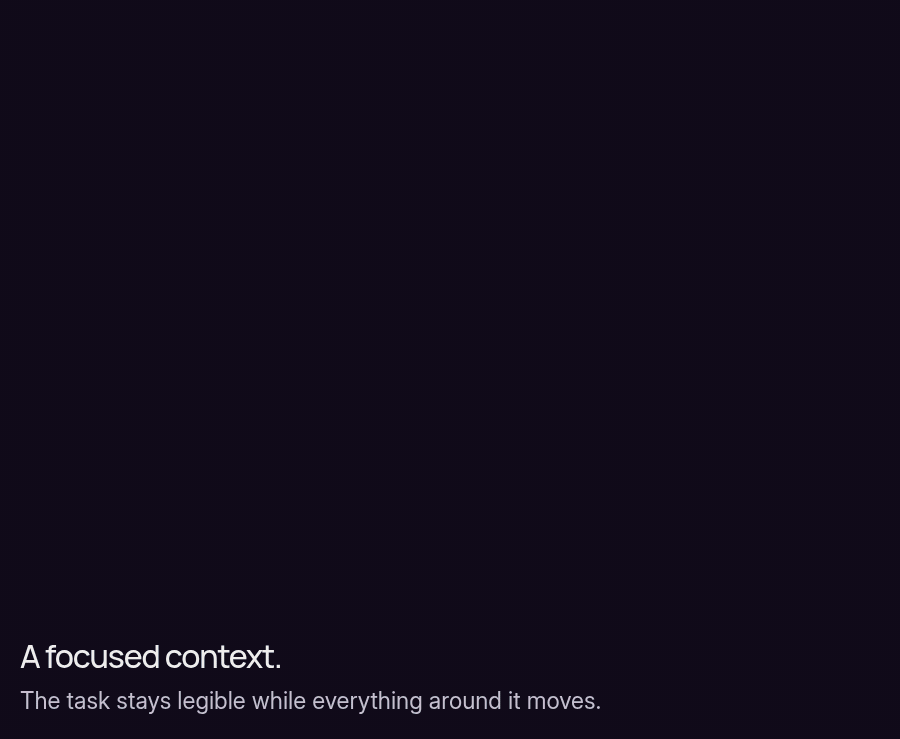
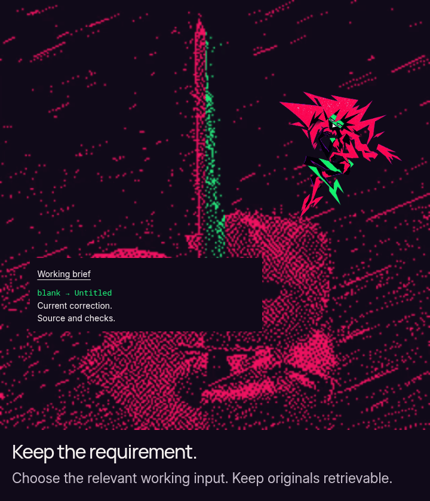
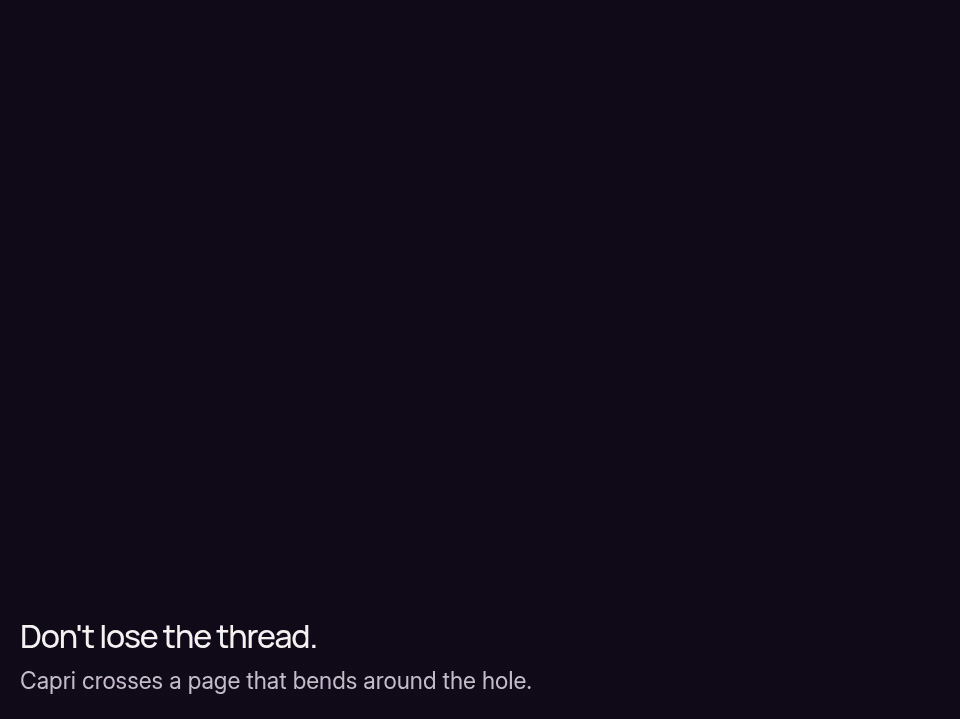
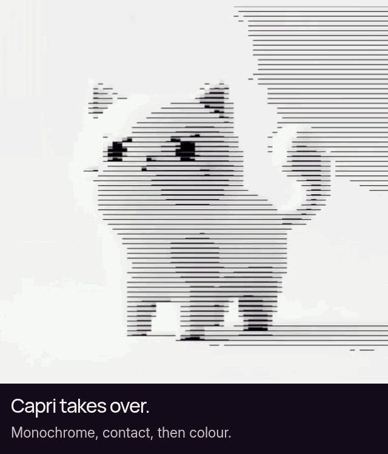
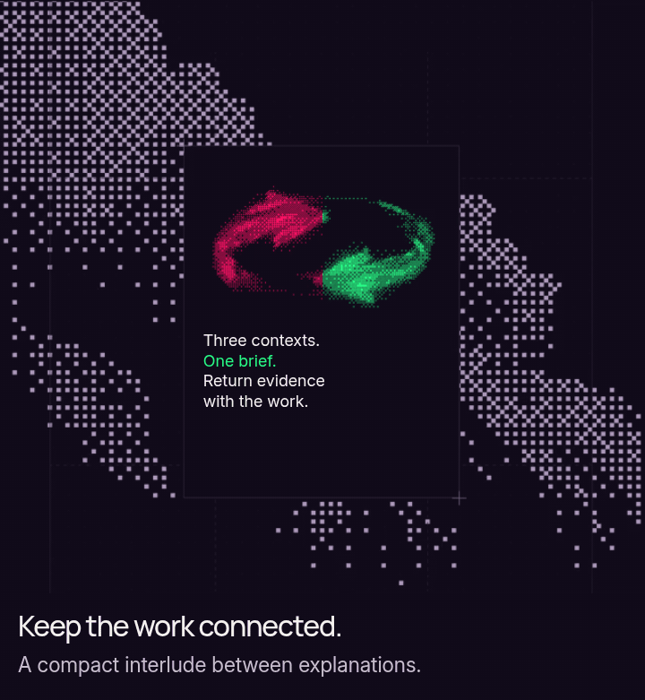

<picture>
  <source media="(prefers-reduced-motion: reduce)" srcset="showcase/capri/hero.png">
  
</picture>

A three-session Codex workflow for research, scoped implementation and independent review. Explicit handoffs carry the decisions; **you decide what ships**.

[Start](#quickstart) · [The loop](#the-loop) · [Context and evidence](#context-and-evidence) · [Field notes](#field-notes)

[Complete static edition](docs/README_STATIC.md) · [Local companion and source record](docs/SOURCE_MATCH.md) · [Current status](docs/STATUS.md)

<a id="the-loop"></a>

## Plan. Build. Review.

<picture>
  <source media="(prefers-reduced-motion: reduce) and (max-width: 760px)" srcset="showcase/capri/source-match/exports/comic-portrait.png">
  <source media="(prefers-reduced-motion: reduce)" srcset="showcase/capri/source-match/exports/comic-wide.png">
  <source media="(max-width: 760px)" srcset="showcase/capri/source-match/exports/comic-portrait.gif">
  
</picture>

1. **Thinker / Plan:** select the request, latest correction, relevant source, allowed changes and acceptance checks. Keep originals retrievable.
2. **Doer / Build:** implement the scoped candidate; return the patch, checks and known limits with the brief.
3. **Reviewer / Review:** compare the request, correction, candidate and evidence in a fresh checking context. Separate sessions can still share model blind spots.
4. **Thinker report → you:** findings and limits return for a human decision. **One write owner; ordered stages. Uncertain effects hold for reconciliation.** Replay in the artwork is not another task or approval.

<details>
<summary><strong>Inside the loop</strong> — models, context and ownership</summary>

All three roles request `gpt-6.1-sol`. The selected profile uses medium Thinker/Doer effort and high Reviewer effort. One owner controls writes. Frozen contracts, checkpoints and source checks bind each handoff to its inputs.

Recent-request footprint, cumulative usage and exact context occupancy are different measurements. Exact occupancy stays **UNKNOWN** where the runtime cannot establish it. Stale inputs or uncertain effects hold work for reconciliation. Formal outcomes stop at `AWAITING_HUMAN`; no successor task starts automatically.

[Native profile](NATIVE_PROFILE.md) · [Architecture](ARCHITECTURE.md) · [Evaluation](EVALUATION.md)

</details>

## Keep the correction with the task

<picture>
  <source media="(prefers-reduced-motion: reduce) and (max-width: 760px)" srcset="showcase/capri/source-match/exports/hands-portrait.png">
  <source media="(prefers-reduced-motion: reduce)" srcset="showcase/capri/source-match/exports/hands-wide.png">
  <source media="(max-width: 760px)" srcset="showcase/capri/source-match/exports/hands-portrait.gif">
  
</picture>

**Authored fixture A illustration, not an observed model result.** The original request trims outer whitespace, preserves case and internal spaces, rejects non-strings, and permits changes only to `label.py`. The latest correction changes the blank label from `Anonymous` to **`Untitled`**; compatible original rules remain. [Original request](evaluation/fixtures/A/INITIAL.md) · [Correction](evaluation/fixtures/A/CORRECTION.md).

| Input | Expected behavior after the correction |
| :--- | :--- |
| `"   "` | `"Untitled"` |
| `"  MiX  Case  "` | `"MiX  Case"` |
| `None` | raises `TypeError` |

A brief saying only “trim text; return Anonymous for blanks” loses the latest decision and compatible constraints. A complete handoff carries **scope + current correction + original rules + source retrieval + checks**. The loss is in that authored brief; it is not cache-driven instruction deletion. [Walk through the explanation](docs/CAPRI_EXPLAINS.md).

<a id="context-and-evidence"></a>

## Supply a focused working context

<picture>
  <source media="(prefers-reduced-motion: reduce) and (max-width: 760px)" srcset="showcase/capri/source-match/exports/sharks-portrait.png">
  <source media="(prefers-reduced-motion: reduce)" srcset="showcase/capri/source-match/exports/sharks-wide.png">
  <source media="(max-width: 760px)" srcset="showcase/capri/source-match/exports/sharks-portrait.gif">
  
</picture>

A context is the information available to a role: instructions, source, history and tool results. Exploration, abandoned alternatives and logs need not fill every later request. Select by purpose while retaining the request, corrections, relevant source and authoritative originals. A short packet that omits a needed rule is still wrong.

<picture>
  <source media="(prefers-reduced-motion: reduce) and (max-width: 760px)" srcset="showcase/capri/source-match/exports/rain-portrait.png">
  <source media="(prefers-reduced-motion: reduce)" srcset="showcase/capri/source-match/exports/rain-wide.png">
  <source media="(max-width: 760px)" srcset="showcase/capri/source-match/exports/rain-portrait.gif">
  
</picture>

### Worked example: assumed input tokens

**Not a measured CAPRI run.** Six requests per policy, including assumed role instructions and handoff inputs:

| Context policy | Assumed input total |
| :--- | ---: |
| Growing history | 180,000 |
| Curated single session | 90,000 |
| Scoped roles | 60,000 |

Under these inputs, scoped requests are **66.7% lower** than growing history and **33.3% lower** than the curated example. The curated single session is itself 50% below growing history. Information sufficiency and equal answer quality have **not** been established. Agent count alone does not create these differences.

<details>
<summary>Inspect all six assumed calls</summary>

| Call | Growing history | Curated session | Scoped roles |
| ---: | ---: | ---: | ---: |
| 1 | 10,000 | 10,000 | 10,000 |
| 2 | 18,000 | 12,000 | 8,000 |
| 3 | 26,000 | 14,000 | 10,000 |
| 4 | 34,000 | 16,000 | 12,000 |
| 5 | 42,000 | 18,000 | 8,000 |
| 6 | 50,000 | 20,000 | 12,000 |
| **Total** | **180,000** | **90,000** | **60,000** |

[Canonical editable inputs](showcase/capri/source-match/source/assets/data/context-budget.json) · [Calculator and complete assumptions](docs/CONTEXT_BUDGET.md) · [Actual benchmark protocol](docs/BENCHMARK_PROTOCOL.md)

</details>

**Fewer raw inputs do not guarantee the same reduction in cost.** At a hypothetical cached relative rate of `0.05`, 50k uncached + 130k cached growing-history inputs use **56.5k weighted units**, below 60k uncached scoped inputs. These are normalized assumptions, not prices. Outputs, coordination, retries, compaction and recovery also matter. Prefix caching reuses eligible computation; it does not delete instructions, create semantic memory or free context-window capacity.

<picture>
  <source media="(prefers-reduced-motion: reduce) and (max-width: 760px)" srcset="showcase/capri/source-match/exports/horizon-portrait.png">
  <source media="(prefers-reduced-motion: reduce)" srcset="showcase/capri/source-match/exports/horizon-wide.png">
  <source media="(max-width: 760px)" srcset="showcase/capri/source-match/exports/horizon-portrait.gif">
  
</picture>

The distinction is between **selecting working inputs** and **preserving authority**. Review rereads the request and checks the patch against evidence. Exact active context occupancy stays **UNKNOWN** when the runtime cannot establish it. [Architecture](ARCHITECTURE.md) · [Benchmark accounting and unrun comparisons](docs/BENCHMARK_PROTOCOL.md).

<a id="quickstart"></a>

## Quickstart

Start with offline inspection from your checkout. Linux x86_64, Python 3.11+ with pip/venv, bubblewrap and working user, mount, PID and network namespaces are required.

```sh
python3 -m venv .venv
. .venv/bin/activate
python -m pip install --require-hashes -r requirements.lock
PYTHONDONTWRITEBYTECODE=1 python -m unittest discover -s controller/tests -v
```

These tests use disposable fixtures and do not call models or require authentication. A failed isolation prerequisite remains a failure.

[Full setup and diagnostics](docs/QUICKSTART.md) · [Host requirements](ENVIRONMENT.md)

<details>
<summary><strong>Before launching native sessions</strong></summary>

Native use additionally requires the qualified Codex CLI 0.163.0/profile, existing local authentication and tmux for ordinary panes. Start from the [preserved implementation guide](IMPLEMENTATION_README.md#native-startup) and an explicitly registered disposable fixture. Later client versions are not implicitly qualified.

[Compatibility](CLIENT_SUPPORT.md) · [Example configuration](examples/config.json)

</details>

## Afterimage

<picture>
  <source media="(prefers-reduced-motion: reduce) and (max-width: 760px)" srcset="showcase/capri/source-match/exports/cat-portrait.png">
  <source media="(prefers-reduced-motion: reduce)" srcset="showcase/capri/source-match/exports/cat-wide.png">
  <source media="(max-width: 760px)" srcset="showcase/capri/source-match/exports/cat-portrait.gif">
  
</picture>

[Open the local interactive companion](docs/SOURCE_MATCH.md#local-companion) for the source-based effects, keyboard controls and motion player. GitHub shows images and native disclosures; scripts, canvas, custom body fonts and live WebGL do not execute in this README.

<picture>
  <source media="(prefers-reduced-motion: reduce) and (max-width: 760px)" srcset="showcase/capri/source-match/exports/dots-portrait.png">
  <source media="(prefers-reduced-motion: reduce)" srcset="showcase/capri/source-match/exports/dots-wide.png">
  <source media="(max-width: 760px)" srcset="showcase/capri/source-match/exports/dots-portrait.gif">
  
</picture>

[Art studies and the optional elastic stack](docs/AFTERIMAGE.md) · [Complete static edition](docs/README_STATIC.md) · [Character reconstruction and source rights](docs/SOURCE_MATCH.md)

<a id="field-notes"></a>

## Field notes

| Open the file | What is inside |
| :--- | :--- |
| [Architecture](ARCHITECTURE.md) | Ownership, confinement, handoffs and recovery |
| [Implementation guide](IMPLEMENTATION_README.md) | Existing commands and the native startup path |
| [Evaluation](EVALUATION.md) | Trial definitions, evidence and comparison limits |
| [Development status](docs/STATUS.md) | What has and has not been qualified |
| [Contributing](CONTRIBUTING.md) | How to work on the project |
| [Security](SECURITY.md) | Boundaries and reporting |
| [Alpha readiness](docs/ALPHA_READINESS.md) | Remaining release gates |
| [Benchmark protocol](docs/BENCHMARK_PROTOCOL.md) | Quality, token use and cost accounting |


> [!IMPORTANT]
> **Experimental.** Current source includes V3 stopped-recovery work; native launch/recovery qualification and formal final review remain pending. Offline CI passed at the recorded base `5215986`; inspect the exact testing-commit result separately. The v4 comparison rows remain unrun. This presentation runs no models and changes no runtime/evaluation state. [Current status](docs/STATUS.md) · [Alpha readiness](docs/ALPHA_READINESS.md).

No source-bound product demo is shown. Character acting is authored fan-art reconstruction; five source panels use reference-footage composites. The shark and horizon effects use actual supplied executable source. [Assets, notices and provenance](docs/SOURCE_MATCH.md#sources-and-rights).

**Mani Marami Milani** · [Afterimage](docs/AFTERIMAGE.md) · [Art credits](docs/ASSETS.md) · [Design references](docs/DESIGN_REFERENCES.md)

Unofficial Capri-inspired fan project; unaffiliated with CD PROJEKT RED, TRIGGER or Netflix. Repository remains private. Code licensing, reference-footage permissions and underlying character-art redistribution rights remain distinct and unresolved where recorded. The approved banner and its original credits are retained; no blanket MIT licence is assigned to this media.
