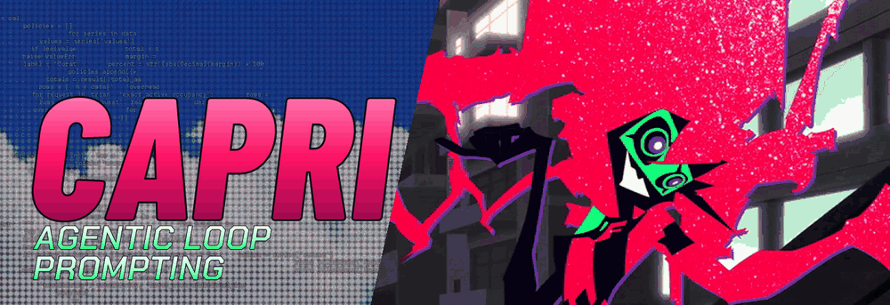
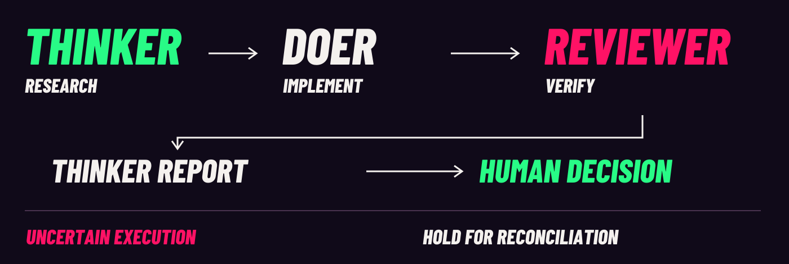
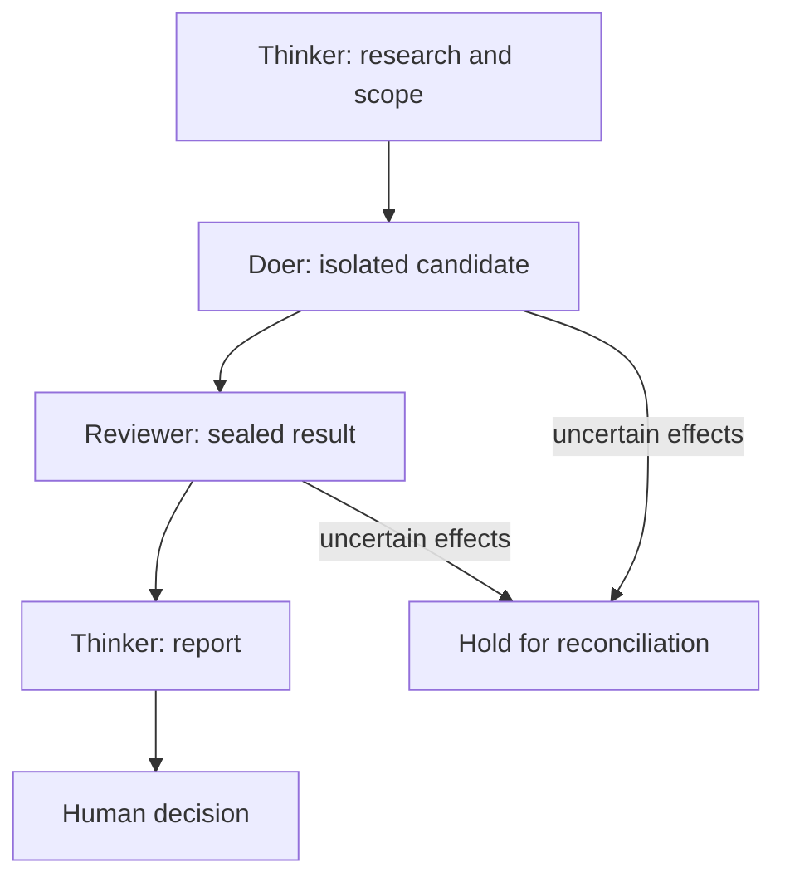

A three-session Codex workflow for research, scoped implementation and independent review. You make the final decision.

<p align="center">
  <a href="#quickstart"></a>
  <a href="#the-loop"></a>
  <a href="docs/AFTERIMAGE.md"></a>
  <a href="#field-notes"></a>
</p>

<p align="center"><a href="docs/README_STATIC.md">Static edition</a> · <a href="docs/STATUS.md">Development status</a> · <a href="docs/ASSETS.md">Art credits</a></p>

<a id="the-loop"></a>
<h2>
<picture>
  <source media="(prefers-color-scheme: dark)" srcset="showcase/capri/identity/chapter-loop-dark.svg">
  
</picture>
</h2>

<picture>
  <source media="(max-width: 600px)" srcset="showcase/capri/identity/loop-map-mobile.svg">
  
</picture>

The **Thinker** researches and scopes. The **Doer** works on an isolated candidate. A fresh **Reviewer** checks the sealed result and evidence. The Thinker reports back; you decide what happens next. This map describes the workflow, not a completed qualification run.

<details>
<summary><strong>Inside the loop</strong> — models, context and ownership</summary>

All three roles request `gpt-6.1-sol`. The selected profile uses medium Thinker/Doer effort and high Reviewer effort. One owner controls writes. Frozen contracts, checkpoints and source checks bind each handoff to its inputs.

Recent-request footprint, cumulative usage and exact context occupancy are different measurements. Exact occupancy stays **UNKNOWN** where the runtime cannot establish it. Stale inputs or uncertain effects hold work for reconciliation. Formal outcomes stop at `AWAITING_HUMAN`; no successor task starts automatically.

[Native profile](NATIVE_PROFILE.md) · [Architecture](ARCHITECTURE.md) · [Evaluation](EVALUATION.md)

</details>

<a id="quickstart"></a>
<h2>
<picture>
  <source media="(prefers-color-scheme: dark)" srcset="showcase/capri/identity/chapter-start-dark.svg">
  
</picture>
</h2>

Start with offline inspection from your checkout. Linux x86_64, Python 3.11+ with pip/venv, bubblewrap and working user, mount, PID and network namespaces are required.

```sh
python3 -m venv .venv
. .venv/bin/activate
python -m pip install --require-hashes -r requirements.lock
PYTHONDONTWRITEBYTECODE=1 python -m unittest discover -s controller/tests -v
```

These tests use disposable fixtures and do not call models or require authentication. A failed isolation prerequisite remains a failure.

[Full setup and diagnostics](docs/QUICKSTART.md) · [Host requirements](ENVIRONMENT.md)

<details>
<summary><strong>Before launching native sessions</strong></summary>

Native use additionally requires the qualified Codex CLI 0.163.0/profile, existing local authentication and tmux for ordinary panes. Start from the [preserved implementation guide](IMPLEMENTATION_README.md#native-startup) and an explicitly registered disposable fixture. Later client versions are not implicitly qualified.

[Compatibility](CLIENT_SUPPORT.md) · [Example configuration](examples/config.json)

</details>

<a href="docs/AFTERIMAGE.md"></a>

<a id="field-notes"></a>
<h2>
<picture>
  <source media="(prefers-color-scheme: dark)" srcset="showcase/capri/identity/chapter-notes-dark.svg">
  
</picture>
</h2>

| Open the file | What is inside |
| :--- | :--- |
| [Architecture](ARCHITECTURE.md) | Ownership, confinement, handoffs and recovery |
| [Implementation guide](IMPLEMENTATION_README.md) | Existing commands and the native startup path |
| [Evaluation](EVALUATION.md) | Trial definitions, evidence and comparison limits |
| [Development status](docs/STATUS.md) | What has and has not been qualified |
| [Contributing](CONTRIBUTING.md) | How to work on the project |
| [Security](SECURITY.md) | Boundaries and reporting |
| [Alpha readiness](docs/ALPHA_READINESS.md) | Remaining release gates |
| [Benchmark protocol](docs/BENCHMARK_PROTOCOL.md) | Quality, token use and cost accounting |

<details>
<summary><strong>Read the handoff map as Mermaid</strong></summary>



The diagram shows intended stage order and the uncertainty branch. It does not claim a successful live run.

</details>

> [!IMPORTANT]
> **Experimental.** The V3 stopped-recovery implementation is included. Native launch integration, completed recovery qualification, the repaired-source comparison and final independent review remain pending. The CI workflow checks both host and isolated-collector suites; inspect the exact commit result. See [current status](docs/STATUS.md).

No source-bound product demo was available. Character animation is artwork, not a controller recording.

**Mani Marami Milani** · [Afterimage](docs/AFTERIMAGE.md) · [Sources and edits](docs/ASSETS.md) · [Presentation references](docs/DESIGN_REFERENCES.md)

Unofficial Capri-inspired fan project; unaffiliated with CD PROJEKT RED, TRIGGER or Netflix. Code licensing and public character-art redistribution remain unresolved.[^art]

[^art]: The hero uses BluRei's source 19; the expression footage uses emdzejus's source 12. Barlow Condensed is bundled under its OFL notice. Uploader attribution does not establish underlying anime-image ownership. [Full asset record](docs/ASSETS.md).
