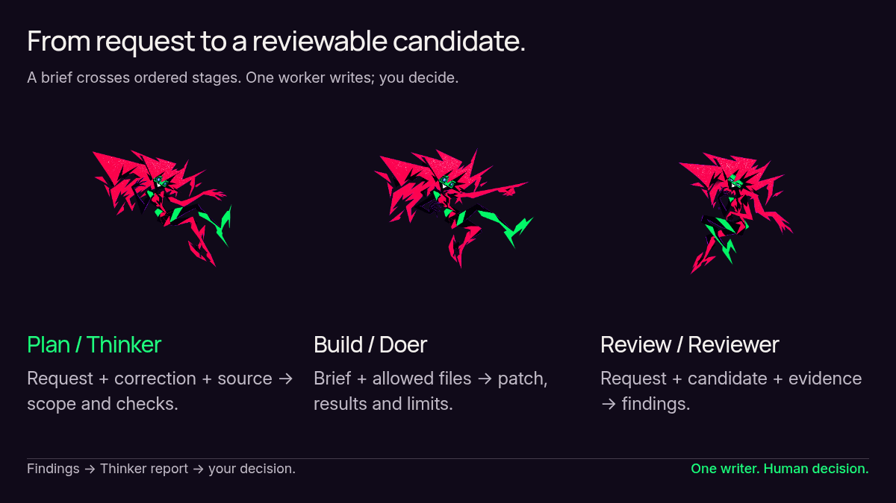
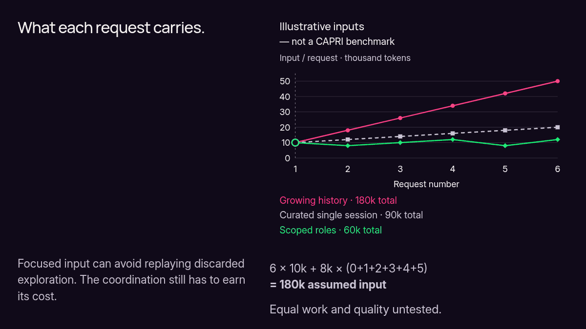
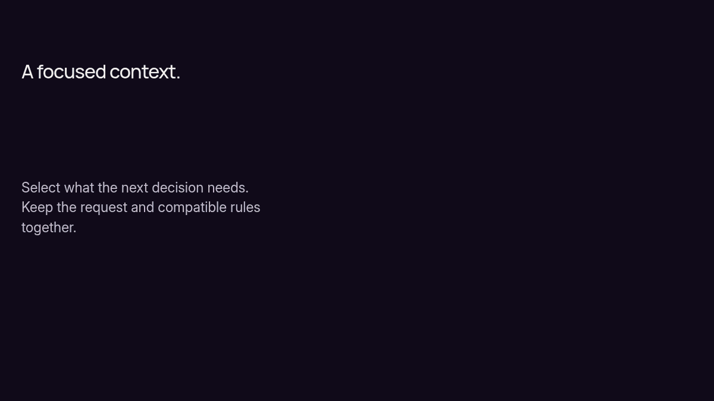
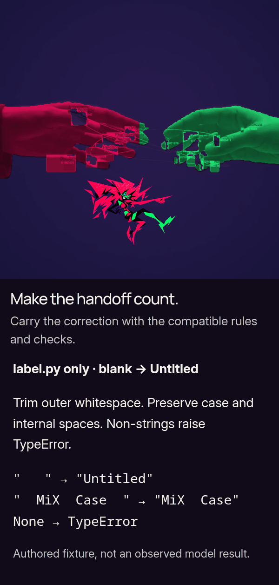
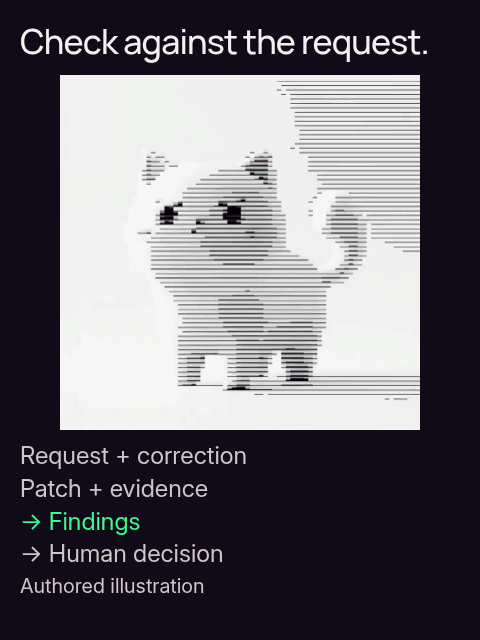
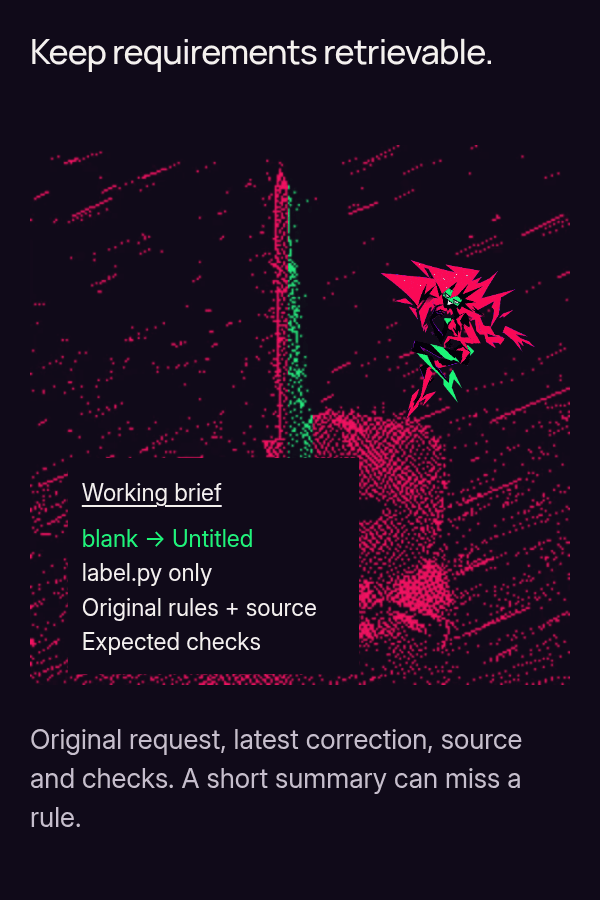
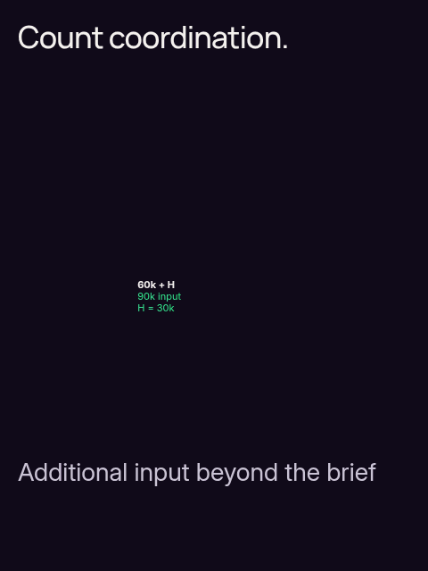
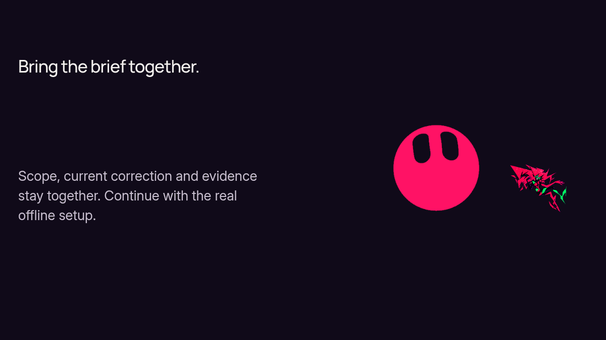

<picture>
  <source media="(prefers-reduced-motion: reduce)" srcset="showcase/capri/hero.png" width="1000" height="343">
  <source srcset="showcase/capri/hero.gif" width="1000" height="343">
  
</picture>

CAPRI gives planning, coding and review their own Codex sessions. Explicit handoffs carry current decisions, relevant files, scope and checks. One worker edits; a separate reviewer checks the candidate against the request and evidence. **You decide what ships.**

**Experimental.** Offline checks cover implementation contracts; native launch/recovery qualification remains pending. [Setup](#quickstart) · [Architecture](ARCHITECTURE.md) · [Current status](docs/STATUS.md) · [Evaluation and evidence](EVALUATION.md).

<a id="the-loop"></a>

## Plan, implement, review

<picture><source media="(prefers-reduced-motion: reduce) and (max-width: 768px)" srcset="showcase/capri/story/exports/workflow-portrait.png" width="600" height="900"><source media="(max-width: 768px)" srcset="showcase/capri/story/exports/workflow-portrait.gif" width="600" height="900"><source media="(prefers-reduced-motion: reduce)" srcset="showcase/capri/story/exports/workflow-landscape.png" width="1200" height="675"><source srcset="showcase/capri/story/exports/workflow-landscape.gif" width="1200" height="675"></picture>

1. **Thinker / Plan:** request + latest correction + relevant source → brief, scope and acceptance checks.
2. **Doer / Build:** brief + allowed files → patch, check results and known limits.
3. **Reviewer / Review:** request + correction + candidate + evidence → findings and uncertainty.
4. **Thinker report → you:** reconcile the evidence and return the decision. **One writer; ordered stages.** Authoritative originals stay retrievable; uncertain effects hold.

<details>
<summary>Inside the loop — models and ownership</summary>

All three roles request `gpt-6.1-sol`. The selected profile uses medium Thinker/Doer effort and high Reviewer effort. Frozen contracts, checkpoints and source checks bind handoffs to their inputs. Formal outcomes stop at `AWAITING_HUMAN`; no successor starts automatically. Separate sessions can still share model blind spots.

[Native profile](NATIVE_PROFILE.md) · [Architecture](ARCHITECTURE.md) · [Qualification status](docs/STATUS.md)

</details>

<a id="context-and-evidence"></a>

## What the next request needs

<picture><source media="(prefers-reduced-motion: reduce) and (max-width: 768px)" srcset="showcase/capri/story/exports/quantitative-portrait.png" width="600" height="900"><source media="(max-width: 768px)" srcset="showcase/capri/story/exports/quantitative-portrait.gif" width="600" height="900"><source media="(prefers-reduced-motion: reduce)" srcset="showcase/capri/story/exports/quantitative-landscape.png" width="1200" height="675"><source srcset="showcase/capri/story/exports/quantitative-landscape.gif" width="1200" height="675"></picture>

Focused contexts can avoid replaying discarded exploration. They still need enough information to do the work. The sharks frame the working brief; the black-hole lesson shows a **six-call input illustration**, not measured occupancy or a claim that caches swallow instructions.

- Growing history: `6 × 10k + 8k × (0+1+2+3+4+5) = 180k`.
- Curated single session: `6 × 10k + 2k × 15 = 90k`.
- Scoped roles: the listed requests sum to **60k**, including assumed role instructions and handoff inputs.

`(180−60)/180 = 66.7%` and `(90−60)/90 = 33.3%` are **lower assumed input**, not measured cost, speed, quality or retention gains. Equal work, sufficient information and equal quality remain untested. A carefully curated single session can match or beat scoped input; role count alone does not cause a saving.

<details>
<summary>Read every assumed input — tokens per request</summary>

| Request | Growing history | Curated single session | Scoped roles |
| ---: | ---: | ---: | ---: |
| 1 | 10,000 | 10,000 | 10,000 |
| 2 | 18,000 | 12,000 | 8,000 |
| 3 | 26,000 | 14,000 | 10,000 |
| 4 | 34,000 | 16,000 | 12,000 |
| 5 | 42,000 | 18,000 | 8,000 |
| 6 | 50,000 | 20,000 | 12,000 |
| **Total** | **180,000** | **90,000** | **60,000** |

The 180k total spans six calls; it is not a simultaneously filled context window. Peak request input is a footprint, not exact active occupancy. Exact occupancy stays **UNKNOWN** where the runtime cannot establish it.

[Canonical assumptions](showcase/capri/source-match/source/assets/data/context-budget.json) · [Full arithmetic and accounting](docs/CONTEXT_BUDGET.md) · [Benchmark protocol and unrun comparisons](docs/BENCHMARK_PROTOCOL.md)

</details>

## Keep the brief focused

<picture><source media="(prefers-reduced-motion: reduce) and (max-width: 768px)" srcset="showcase/capri/story/exports/brief-portrait.png" width="600" height="900"><source media="(max-width: 768px)" srcset="showcase/capri/story/exports/brief-portrait.gif" width="600" height="900"><source media="(prefers-reduced-motion: reduce)" srcset="showcase/capri/story/exports/brief-landscape.png" width="1200" height="675"><source srcset="showcase/capri/story/exports/brief-landscape.gif" width="1200" height="675"></picture>

Select what the next decision needs: request, latest correction, relevant source, allowed files and checks. Keep authoritative originals retrievable.

## Keep the correction attached

<!-- portrait-pair:handoff,checking -->
<table><tr><th>Carry the correction</th><th>Check the candidate</th></tr><tr><td width="50%"><picture><source media="(prefers-reduced-motion: reduce)" srcset="showcase/capri/story/exports/handoff-portrait.png" width="600" height="900"><source srcset="showcase/capri/story/exports/handoff-portrait.gif" width="600" height="900"></picture></td><td width="50%"><picture><source media="(prefers-reduced-motion: reduce)" srcset="showcase/capri/story/exports/checking-portrait.png" width="600" height="900"><source srcset="showcase/capri/story/exports/checking-portrait.gif" width="600" height="900"></picture></td></tr><tr><td><a href="showcase/capri/story/exports/handoff-portrait.png">Full portrait</a></td><td><a href="showcase/capri/story/exports/checking-portrait.png">Full portrait</a></td></tr></table>
<!-- /portrait-pair -->

**Authored fixture A, not a recorded model result.** An incomplete brief such as “return Untitled for blanks” loses compatible rules. The complete packet carries the original request, latest correction, relevant source, file scope and expected checks:

| Check | Expected result after the correction |
| :--- | :--- |
| `"   "` | `"Untitled"` |
| `"  MiX  Case  "` | `"MiX  Case"` |
| `None` | raises `TypeError` |
| Changed files | only `label.py` |

Trim **outer** whitespace; preserve case and internal spaces. The latest correction replaces `Anonymous` with `Untitled` for blanks. Review can reread the [original request](evaluation/fixtures/A/INITIAL.md) and [correction](evaluation/fixtures/A/CORRECTION.md). A summary can omit a needed requirement; that is not cache-driven instruction deletion.

## Check the candidate against the request


A fresh checking context compares the request and correction with the candidate and its evidence. Shared model blind spots remain possible. Findings and limits return to the human; the illustration is not a native controller recording or an approval.

There is no completed native comparison proving CAPRI cheaper, faster or better at requirements retention. Offline CI, model outcomes, total cost and visual approval are separate evidence. [Current status](docs/STATUS.md) · [Evaluation](EVALUATION.md).

## Keep requirements; count coordination

<!-- portrait-pair:requirements,coordination -->
<table><tr><th>Retain requirements</th><th>Count coordination input</th></tr><tr><td width="50%"><picture><source media="(prefers-reduced-motion: reduce)" srcset="showcase/capri/story/exports/requirements-portrait.png" width="600" height="900"><source srcset="showcase/capri/story/exports/requirements-portrait.gif" width="600" height="900"></picture></td><td width="50%"><picture><source media="(prefers-reduced-motion: reduce)" srcset="showcase/capri/story/exports/coordination-portrait.png" width="600" height="900"><source srcset="showcase/capri/story/exports/coordination-portrait.gif" width="600" height="900"></picture></td></tr><tr><td><a href="showcase/capri/story/exports/requirements-portrait.png">Full portrait</a></td><td><a href="showcase/capri/story/exports/coordination-portrait.png">Full portrait</a></td></tr></table>
<!-- /portrait-pair -->

Shortening input is useful only if needed information remains available. Keep authoritative originals for implementation and review. Separate checking can challenge a candidate, but it also adds coordination, output and time.

Let **H** be additional input beyond the scoped example's already-budgeted instructions and handoffs. Scoped input becomes **60k + H**; its input margin versus curated is **30k − H**. At **H = 30k**, that raw-input advantage disappears. Do not count an included handoff twice.

<details>
<summary>Inspect additional-input sensitivity and cost limits</summary>

| Additional H | Scoped input | Relation to curated 90k |
| ---: | ---: | :--- |
| 0k | 60k | 33.3% lower assumed input |
| 15k | 75k | 16.7% lower assumed input |
| 30k | 90k | equal assumed input |
| 45k | 105k | 16.7% higher assumed input |

A short, clear task often fits one ordinary session. Use explicit handoffs when a plan, scoped implementation and separate checking are useful; the coordination has to earn its cost.

Prefix caching reuses matching computation. It does not delete instructions, create semantic memory or free context capacity. Fewer raw inputs do not determine the price order. Actual accounting needs disjoint ordinary-input, cached-read, cache-write and output buckets, applicable tiers, and every role/probe/retry/compaction/recovery attempt. [Detailed assumptions and simplified cache counterexample](docs/CONTEXT_BUDGET.md) · [Actual measurement protocol](docs/BENCHMARK_PROTOCOL.md).

</details>

<a id="quickstart"></a>

## Start with offline checks

Start with offline inspection from your checkout. Linux x86_64, Python 3.11+ with pip/venv, bubblewrap and working user, mount, PID and network namespaces are required.

```sh
python3 -m venv .venv
. .venv/bin/activate
python -m pip install --require-hashes -r requirements.lock
PYTHONDONTWRITEBYTECODE=1 python -m unittest discover -s controller/tests -v
```

These tests use disposable fixtures and do not call models or require authentication. A failed isolation prerequisite remains a failure.

[Full setup and diagnostics](docs/QUICKSTART.md) · [Host requirements](ENVIRONMENT.md)

<details>
<summary><strong>Before launching native sessions</strong></summary>

Native use additionally requires the qualified Codex CLI 0.163.0/profile, existing local authentication and tmux for ordinary panes. Start from the [preserved implementation guide](IMPLEMENTATION_README.md#native-startup) and an explicitly registered disposable fixture. Later client versions are not implicitly qualified.

[Compatibility](CLIENT_SUPPORT.md) · [Example configuration](examples/config.json)

</details>

<picture><source media="(prefers-reduced-motion: reduce) and (max-width: 768px)" srcset="showcase/capri/story/exports/closing-portrait.png" width="600" height="900"><source media="(max-width: 768px)" srcset="showcase/capri/story/exports/closing-portrait.png" width="600" height="900"><source media="(prefers-reduced-motion: reduce)" srcset="showcase/capri/story/exports/closing-landscape.png" width="1200" height="675"><source srcset="showcase/capri/story/exports/closing-landscape.png" width="1200" height="675"></picture>

## Explore the working source

[Interactive companion](docs/VISUAL_STORY.md#local-companion) · [Single-column static/mobile edition](docs/README_STATIC.md) · [Detailed explanation](docs/CAPRI_EXPLAINS.md) · [Art studies](docs/AFTERIMAGE.md) · [Asset provenance and rights](docs/SOURCE_MATCH.md#sources-and-rights)

GitHub displays exported media, links and native disclosures. Portrait tables retain two columns on narrow views; all essential rules and numbers are readable below, with full portraits and a single-column static edition. The local companion provides request selection, additional-input control, play/pause/replay/seek and source interactions. Its controls change real local scene state.

| Documentation | Purpose |
| :--- | :--- |
| [Architecture](ARCHITECTURE.md) | Ownership, handoffs, confinement and recovery |
| [Implementation guide](IMPLEMENTATION_README.md) | Existing commands and native startup |
| [Benchmark protocol](docs/BENCHMARK_PROTOCOL.md) | Quality, usage, cost and missing evidence |
| [Current status](docs/STATUS.md) | Qualification and human review gates |
| [Visual story build/source record](docs/VISUAL_STORY.md) | Canonical inputs, edited scenes, exports and verification |
| [Contributing](CONTRIBUTING.md) | Project change discipline |

**Mani Marami Milani.** Unofficial Capri-inspired fan project; unaffiliated with CD PROJEKT RED, TRIGGER or Netflix. Original banner and all source credits remain preserved. Native sharks/horizon use actual source implementations; five other effect families are credited footage composites. Character acting is fan-art reconstruction, not an official rig or exact anime acting. Source reuse and underlying character rights remain as recorded; repository stays private.
