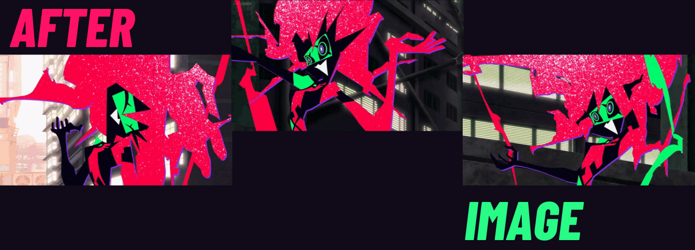
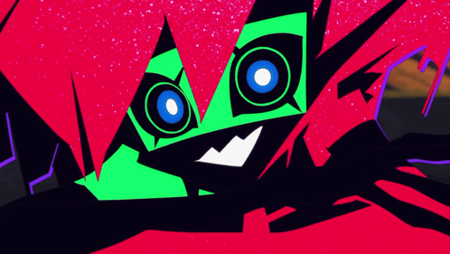
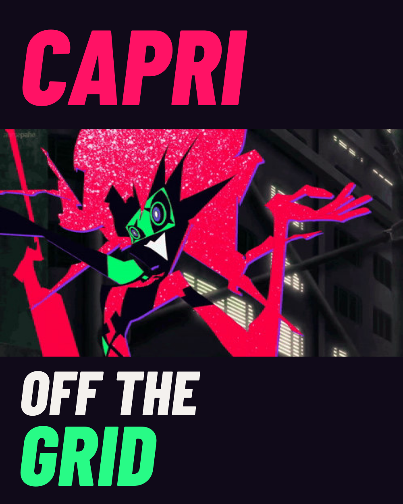

<a href="../README.md">CAPRI</a> · <a href="README_STATIC.md">Static edition</a> · <a href="ASSETS.md">Sources</a>

# Afterimage

A Capri art interlude: expressions, long hands, sharp silhouettes and abrupt changes of pose. These are character studies and original editorial compositions, not product demonstrations or official show artwork.

## In motion

The original 1.1-second expression clip, credited to emdzejus. [Open a still instead](../showcase/capri/identity/chapter-art-dark.svg). GitHub Markdown has no custom play/pause control.

<strong>Open the poster</strong> — Off the Grid

*Off the Grid* is an editorial title for this poster, not a show quote, capability claim or runtime state. The character pose is from source 19; no missing anatomy or standalone model has been invented.

<strong>Palette and lettering</strong>

| Ink | Magenta | Green | Paper |
| --- | --- | --- | --- |
| `#100A19` | `#FF1265` | `#28FB86` | `#F4F1EE` |

Working presentation colors, not official production specifications. Barlow Condensed ExtraBold Italic is outlined in the SVGs; GitHub controls the native body font. The supplied font and OFL notice are retained.

[Editable SVGs](../showcase/capri/identity) · [Rebuild script](../tools/build_capri_identity.py) · [Art provenance and reuse status](ASSETS.md)
