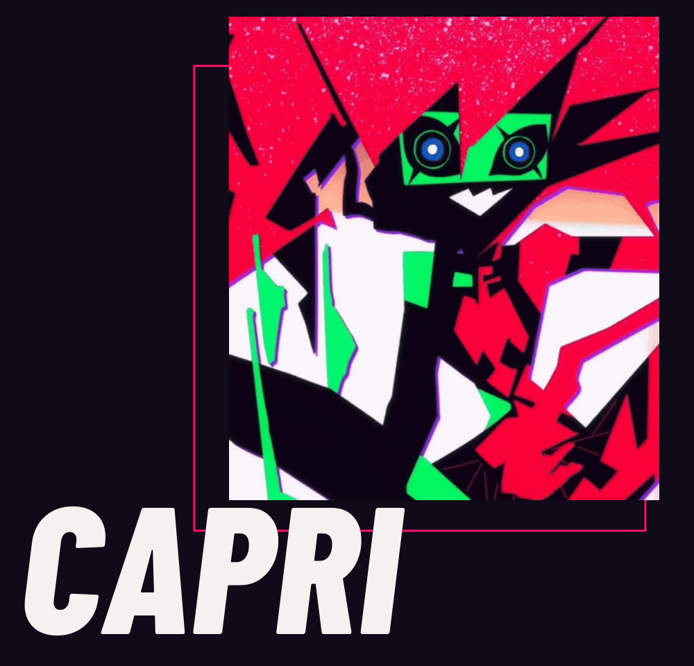
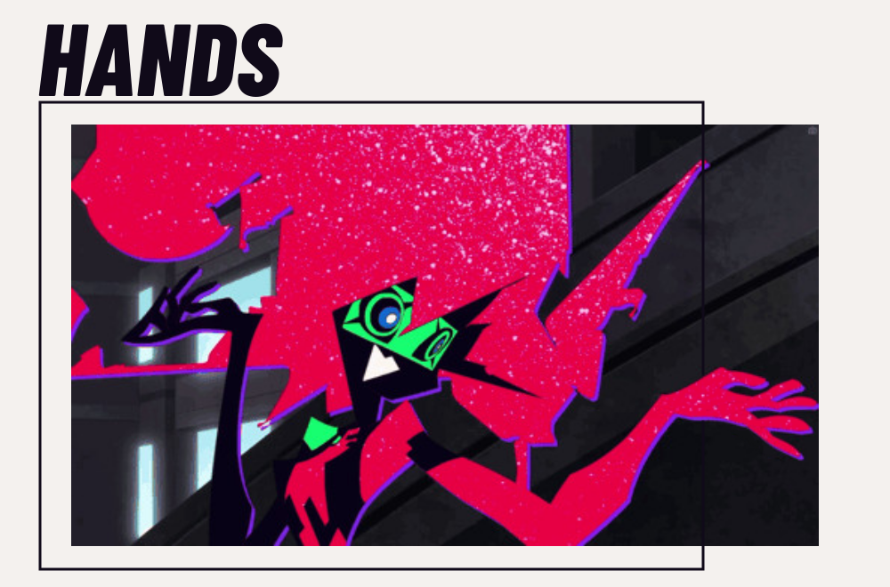
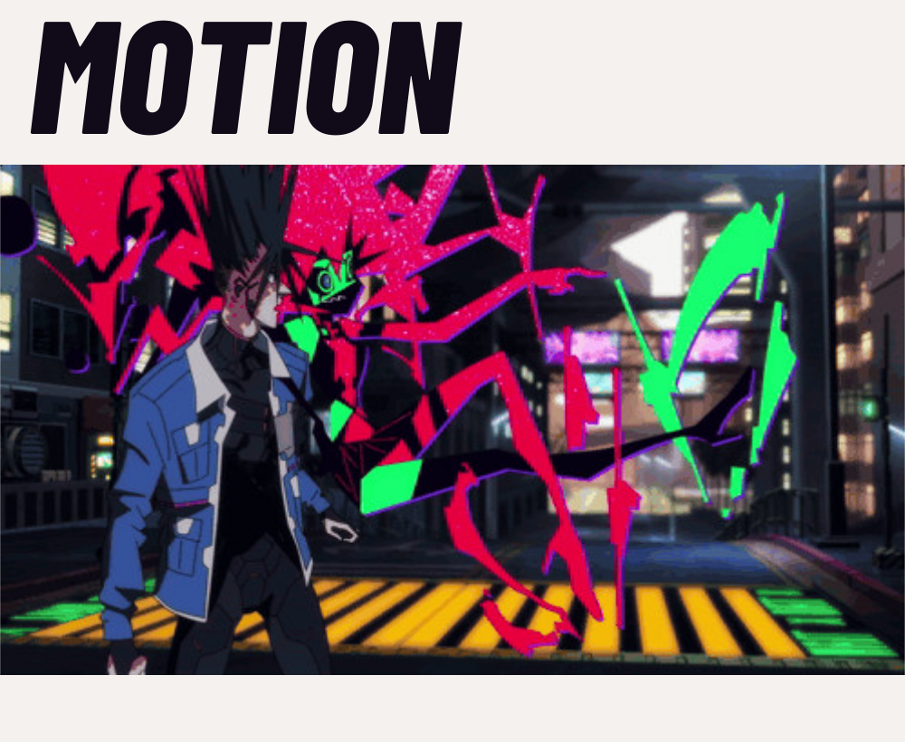
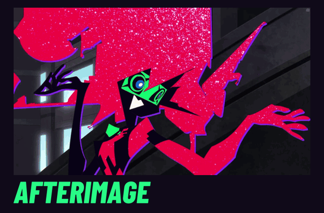

<a href="../README.md">CAPRI</a> · <a href="AFTERIMAGE.md">Animated edition</a> · <a href="README.md">Field notes</a> · <a href="ASSETS.md">Sources</a>

# Afterimage

Eyes first. Then the hands. Then the whole room.

Three source-derived compositions and one motion interlude, made from Capri's actual poses. This is an art page; these images are neither product demonstrations nor official show artwork.

<picture>
  <source type="image/svg+xml" srcset="../showcase/capri/afterimage/expression.svg">
  
</picture>

The portrait keeps the complete original image box: face, hand, tilted jaw and the bright field around her. [Source 1 · kiraGIFtendency](https://tenor.com/view/capri-cyberpunk-cyberpunk-2077-cyberpunk-edgerunners-capri-edgerunners-gif-10230541622417664644).

## Hands

<picture>
  <source type="image/svg+xml" srcset="../showcase/capri/afterimage/gesture.svg">
  
</picture>

One visible pose, with the right hand layered over the frame. The entire source box remains beneath it; no missing body parts were drawn. [Source 14 · emdzejus](https://tenor.com/view/cyberpunk-cyberpunk-edgerunners-cyberpunk-2077-capri-capricorn-gif-16452655038391929723) · [Hand foreground layer](../showcase/capri/afterimage/gesture-hand-layer.png).

## Motion through space

<picture>
  <source type="image/svg+xml" srcset="../showcase/capri/afterimage/movement.svg">
  
</picture>

The environmental frame gives her movement a scale and a place. The other figure stays in the source image; this is not an isolated character model. [Source 20 · Strawhat131331](https://tenor.com/view/capri-capri-cyberpunk-2-capri-cyberpunk-cyberpunk-2-cyberpunk-edgerunners-2-gif-13632704091127032668).

## Hand signals

This still preserves the opening pose of the edit. The 5.3-second animated version retains all 4.3 seconds of source 14 at their original pace. Opening and closing holds surround the acting; one 80 ms ink cut stays inside the image box. The loop returns to its opening pose while the title remains still. [Open the still](../showcase/capri/afterimage/interlude.png) · [Still edition](AFTERIMAGE_STATIC.md).

GitHub controls GIF autoplay. The local review preview has working pause and reduced-motion controls; those controls are not README functionality.

<strong>The approved collection</strong> — triptych, poster and expression source

Three moments from the same source, retained as the approved V4 triptych.

*Off the Grid* is original editorial copy, not a show quote or a software capability. [Original expression loop · source 12](../showcase/capri/sources/capri-12.gif) · [Expression still](../showcase/capri/identity/chapter-art-dark.svg).

<strong>Palette, lettering and source craft</strong>

| Ink | Magenta | Green | Paper |
| --- | --- | --- | --- |
| `#100A19` | `#FF1265` | `#28FB86` | `#F4F1EE` |

Working presentation colors, not official production specifications. Barlow Condensed ExtraBold Italic supplies the outlined display lettering; native body text remains GitHub's. The source clips are 443–498 pixels wide. Composition exports add framing, not new image detail.

The hand foreground mask contains original source pixels and a manually authored boundary. An attempted full-figure matte was discarded because it damaged dark edges. No generative fill, interpolated character frames or complete rig is used. Uploader attribution does not establish underlying anime rights; this candidate stays private.

[Editable compositions and timing](../showcase/capri/afterimage/COMPOSITION.json) · [Rebuild](../tools/build_capri_afterimage.py) · [Sources and exact frame ranges](ASSETS.md#v5-afterimage) · [Design adaptation](DESIGN_REFERENCES.md#v5-expansion)
