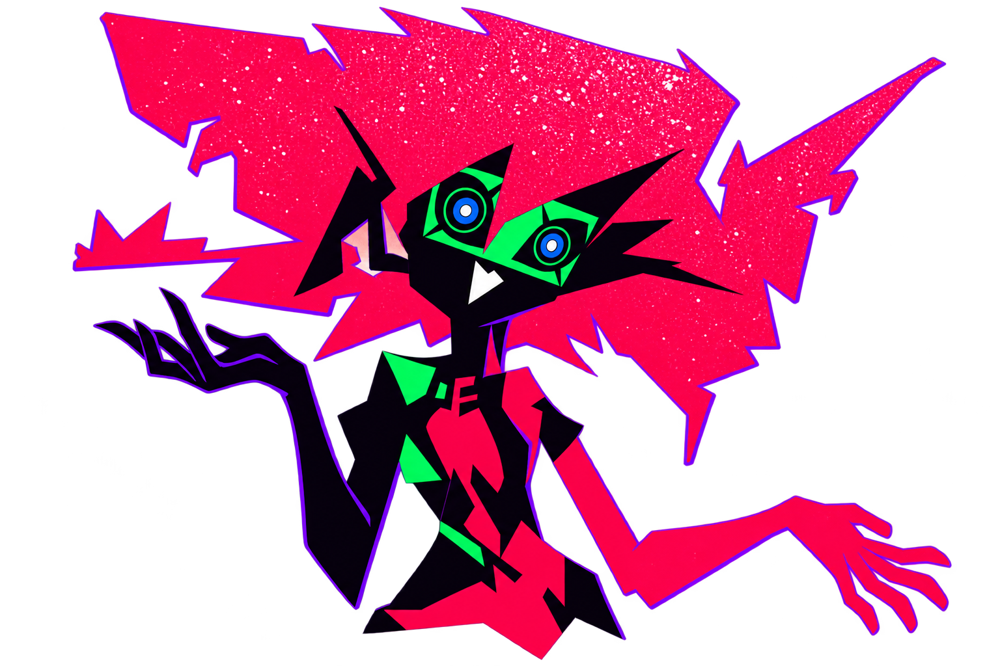
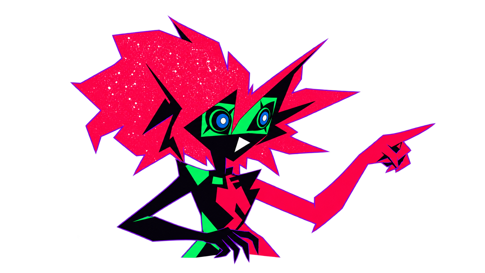
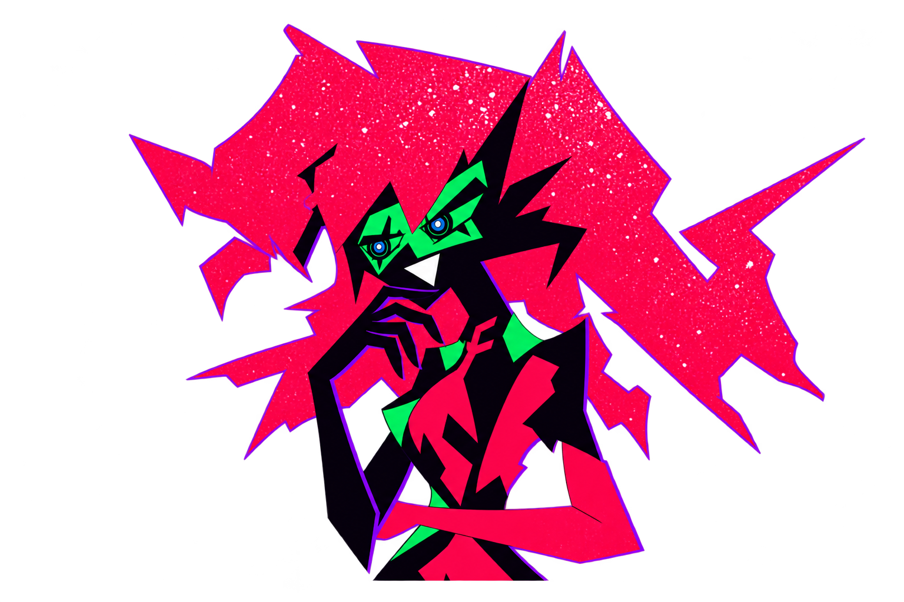
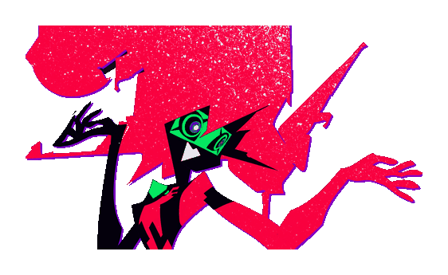

# Capri: three poses, one scene

[Back to the lesson](../README.md#the-loop) · [Full art record](ASSETS.md)

The root lesson uses **explain, point and inspect**, three supplied AI-assisted fan-art studies. They differ in head angle, shoulder/torso direction and arm silhouette. They are upper-body studies, not official model sheets, extracted animation, a 3D model or a complete rig. Human visual approval is pending.

| Explain | Point | Inspect |
| :--- | :--- | :--- |
|  |  |  |

[Ink, paper and checkerboard proof](../showcase/capri/poses/alpha-proof.png) · [Measured anchors](../showcase/capri/poses/ANCHORS.json) · [Original studies and exact prompts](../showcase/capri/poses/references) · [Supplied provenance](../showcase/capri/poses/ASSET_RECORD.json) · [Original reference frames](../showcase/capri/poses/original-references)

## Source and alignment

Mani's explicit character-art generation exception continues for these poses. The handoff supplied them; V8 performs **no new model generation**. Original studies and prompts remain byte-identical. Only near-opaque alpha (249–254) is normalized to 255; black anatomy is retained. No flattened image is keyed, no missing body is invented and no face is elastically morphed. Source crops remain; the stage adds no further clipping at normal poses.

Eye pairs, mouth, chest and active fingertip are measured in each source's original canvas. A similarity transform matches the eye midpoint and a 44-unit apparent inter-eye span. The complete face/hairstyle differs with perspective; geometric equality alone is not a fidelity approval. Scene-space anchors derive from the same transform used to render the pose. Captions are intentionally tail-free, clear of hair and hands. The Build leader starts at the actual transformed fingertip and ends at the current correction packet.

## One clock and reproducible media

`sample_scene(time_ms, layout)` in [the builder](../tools/build_capri_scene.py) owns pose, caption, active phase, packet, gesture and anchors. Wide and portrait exports share all four semantic beats. The local player samples its **60 Hz JSON master**; the GIF samples that same pure function at **25 Hz, 40 ms moving intervals**. Identical reading holds merge and are reported separately from motion. No source-acting FPS is claimed.

The 18-second teaching loop uses four 4-second reading/acting beats and four 500 ms boundaries. A brief 8-unit exit and opacity reduction precede a hidden pose/caption change, then a matched-eye reveal. Only one complete face is rendered at a time. The last-to-first boundary retains explain, so there is no long return trip or blank actor. A small 16-unit packet reveal accompanies the opening of each beat. Captions stay fixed while read. This authored replay is not a controller action or approval.

Full RGBA pose masters remain editable. Complete GIF scenes are **opaque ink-backed compositions**, not transparent actors. A shared palette prevents per-frame palette flashing. [Scene master and actual text bounds](../showcase/capri/scene/SCENE.json) · [Hashes and bytes](../showcase/capri/scene/BUILD.json). Anchor overlays sit alongside the four static beats in the scene directory.

## Build

Use Pillow/fontTools from the existing media environment, system `rsvg-convert`, **PyGObject, Pango, Pycairo and Fontconfig** (system media tools; runtime requirements and locks stay unchanged). Bundled Barlow fonts are registered only in the builder process. Pango shapes/kerning precede Cairo outline conversion; actual ink bounds guard text fit. Do not substitute manual glyph advances.

```sh
python tools/build_capri_scene.py
python tools/build_capri_static.py
python tools/check_capri_presentation.py
```

Pause retains the player's sampled state; resume continues from that time. Previous/next, backward seek and reduced motion select a complete scene without reconstructing earlier events. GitHub gets portable GIF/SVG media, native transcript and static route, without custom controls. Mechanical checks and recorded playback do not establish perceived smoothness. Continuous perceptual review and physical-device review must be reported separately.

## Preserved V7 actor and method

The earlier one-pose wrist articulation remains recoverable below and in its unchanged masters. It is retired from the root lesson.

### V7 transparent actor

[Back to the guide](../README.md#the-loop) · [Full art record](ASSETS.md).



[Static alpha pose](../showcase/capri/actor/actor.png) · [48-frame full-alpha PNG/APNG master](../showcase/capri/actor/actor-rgba.png) · [Separate animated RGB master](../showcase/capri/actor/actor-rgb.png) · [Separate animated alpha master](../showcase/capri/actor/actor-alpha.png) · [Body layer](../showcase/capri/actor/body.png) · [Left palm](../showcase/capri/actor/left_palm.png) · [Right palm](../showcase/capri/actor/right_palm.png) · [Editable recipe](../showcase/capri/actor/ANIMATION.json).

## Provenance and method

V7 explicitly authorized AI assistance for this asset. The handoff supplied an AI-edited cutout from source 14/frame 0 with source 20/frame 101 as an identity reference. The [unaltered candidate and original edit record](../showcase/capri/actor/references/ASSET_RECORD.json) and [exact supplied prompt](../showcase/capri/actor/references/CUTOUT_PROMPT.md) remain separate from the original footage's [source hashes and credits](../showcase/capri/SOURCES.json).

CPU source-mask propagation and manual source-pixel mask trials were inspected and rejected for room contamination or gaps in black anatomy. The final actor uses the explicitly permitted alternative: the supplied edited pose with coherent source-guided hand animation. RGB and alpha are separately editable APNG masters, and each articulated layer has a grayscale mask beside it. Recombine RGB with its paired alpha; the RGB master alone is an opaque color plane. Body/face/hair pixels stay fixed; the separate palms make restrained rotations at original-pixel wrist overlaps. This is authored 2D articulation, not original anime acting sampled at 24 FPS or independent per-frame AI generation. No new generative frames, face reconstruction or missing anatomy are invented.

The edited pose is not source-pixel-identical. Its original upper-body crop remains, including cut top/bottom forms. Padding prevents additional hand clipping during rotation; it is not a complete body or official rig. Upscaling in the handoff does not create an original HD source. Underlying anime redistribution rights remain unresolved.

## Timing and transparency

Standalone actor: **48 distinct decoded frames over 2,000 ms**, 24 samples/s, using rounded cumulative centisecond timestamps (40/50 ms delays). The full-alpha APNG master preserves soft edges; GIF uses reserved transparent palette index 0 and explicit disposal 2. Every decoded GIF alpha mask is compared with the alpha master to detect retained hands/trails. Black character pixels stay opaque.

The integrated 16-second guides retain four 3.5-second reading intervals and 0.5-second transitions. Each reading interval contains a quiet two-second authored gesture followed by a 1.5-second still. Active position travel uses 12 distinct samples over 500 ms, approximately 24 samples/s; the stationary Reviewer→report transition is not counted as position travel. Travel keeps one pointing pose so arrival does not reset a moving hand phase. The actor and path cadence are recorded separately. The approved 12 FPS banner is unchanged and is not called 60 FPS.

[Actual frame delays, uniqueness, transforms and bytes](../showcase/capri/actor/BUILD.json) · [Guide build](../showcase/capri/explainer/BUILD.json) · [Ink, paper and checkerboard still proof](../showcase/capri/actor/matte-proof.png). The checkerboard is a proof backdrop, never baked into the transparent GIF.

The timing/disposal rules follow the [GIF89a specification](https://www.w3.org/Graphics/GIF/spec-gif89a.txt) and [Pillow GIF documentation](https://pillow.readthedocs.io/en/stable/handbook/image-file-formats.html). Mechanical checks, screenshots and recordings do not award continuous perceptual or human visual approval. Hosted GitHub behavior must be distinguished from local previews.

## Rebuild the editable assets

Use the existing separate media environment (`requirements-media.txt`) and system `rsvg-convert`:

```sh
python tools/build_capri_actor.py
python tools/build_capri_explainer.py
python tools/build_capri_numbers.py
python tools/check_capri_presentation.py
```

No controller, native sessions, paid trials, runtime dependencies or model budgets are involved. Local preview controls are review features; GitHub Markdown retains the GIF and complete static/native-text alternatives.
