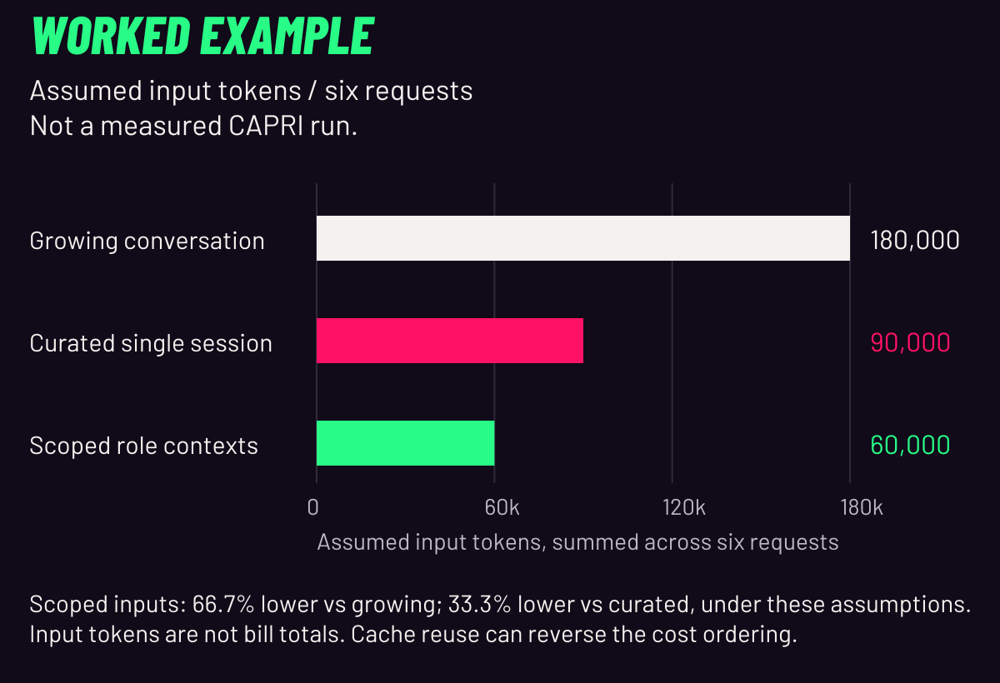

# A worked context budget

**Worked example — assumed input tokens, not a measured CAPRI run.** These counts are arithmetic inputs, not tokenizer output, model usage or evidence of equal task quality. [README](../README.md) · [Current evidence](CAPRI_EXPLAINS.md#what-is-proven-here).

<picture>
  <source media="(max-width: 600px)" srcset="../showcase/capri/context-budget/budget-mobile.svg">
  
</picture>

## Three different mechanisms

| Mechanism | What it does | Failure to guard against |
| :--- | :--- | :--- |
| Context selection | Chooses the instructions, messages, source and tool results for the next call | Relevant information can be buried or excluded |
| Compaction or handoff | Selects or re-expresses history for later work | A lossy brief can omit a correction, exception or its source |
| Prefix caching | Reuses processing for a matching prompt prefix | Prefix changes can reduce reuse; a cache hit does not delete instructions |

Growing context means more material to manage. Selection/compaction can lose requirements if poorly done. Necessary instructions are not automatically waste. Keep current requirements explicit and original sources retrievable. [Context-engineering guidance](https://www.anthropic.com/research/effective-context-engineering-for-ai-agents) · [OpenAI prefix caching](https://developers.openai.com/api/docs/guides/prompt-caching). CAPRI separately records cumulative usage, last-request footprint, cached input and **UNKNOWN** exact active occupancy. [Implementation](../controller/loop/context.py).

## Inspect the six calls

**Worked example — assumed input tokens, not a measured CAPRI run.**

| Request | Growing history | Curated single session | Scoped roles | Scoped role |
| :--- | ---: | ---: | ---: | :--- |
| 1 | 10,000 | 10,000 | 10,000 | Thinker: plan |
| 2 | 18,000 | 12,000 | 8,000 | Doer: inspect |
| 3 | 26,000 | 14,000 | 10,000 | Doer: implement |
| 4 | 34,000 | 16,000 | 12,000 | Doer: checks |
| 5 | 42,000 | 18,000 | 8,000 | Reviewer |
| 6 | 50,000 | 20,000 | 12,000 | Thinker: report |
| **Total input** | **180,000** | **90,000** | **60,000** | Six calls included |

The growing sequence starts at 10,000 and adds 8,000 per call. The curated and scoped sequences assume sufficient relevant information fits their budgets. Handoff construction and review context are included in the scoped inputs; their sufficiency and output quality have not been tested. All six calls count, and equality of calls does not establish equal work or answers.

Under those assumptions, `(180000 - 60000) / 180000` is **66.7% less input** and `(90000 - 60000) / 90000` is **33.3% less input**. Largest assumed request is 50,000 versus 12,000 tokens. These are input-footprint comparisons, not exact occupancy, retention scores, speed or bills. The strong curated-single-session case shows context management can help one session too. Role count is not the cause by itself.

## Cache sensitivity can reverse the cost ordering

Assume perfect reusable growing-history prefixes: 50,000 uncached + 130,000 cached input tokens. Assume all 60,000 scoped input tokens miss cache. For a **hypothetical**, normalized cached relative rate `r`, weighted input units are `uncached + r × cached`:

| Hypothetical r | Growing weighted units | Scoped weighted units | Scoped difference |
| :--- | ---: | ---: | :--- |
| 1.00 | 180,000 | 60,000 | 66.7% lower |
| 0.10 | 63,000 | 60,000 | 4.8% lower |
| 0.05 | 56,500 | 60,000 | 6.2% higher |

The ratios are not current provider prices and the units are not dollars. This input-only illustration excludes output/reasoning charges, cache writes, tools, retries, latency, wall time, human work and quality. Smaller inputs alone cannot establish a lower bill. A smaller handoff can reduce repeated input; check cache, outputs and results before calling it cheaper.

## Keep the requirement in the packet

**Authored packing examples, not observed model failures.**

> Incomplete: “Trim text and return Anonymous for blanks.”

> Complete: “Only change label.py. Trim outer whitespace; preserve case and internal whitespace. Latest correction: blank/whitespace-only input returns Untitled. Non-strings raise TypeError. Original request and correction remain linked.”

The first brief contains the superseded blank rule and omits compatible requirements. The complete one retains them. Expected checks remain `"   " → "Untitled"`, `"  MiX  Case  " → "MiX  Case"`, and `None → TypeError`. This demonstrates a missing line in an authored brief, not an actual model failure or invented retention measurement. [Original request](../evaluation/fixtures/A/INITIAL.md) · [Latest correction](../evaluation/fixtures/A/CORRECTION.md).

<a id="reproduce-the-example"></a>

## Reproduce the example

```sh
python3 showcase/capri/context-budget/calculate.py
```

[Edit scenario.json](../showcase/capri/context-budget/scenario.json) · [Calculator](../showcase/capri/context-budget/calculate.py) · [Reproducible results](../showcase/capri/context-budget/results.json) · [Chart builder](../tools/build_capri_numbers.py). If you edit the assumed counts, rebuild results/charts and update the matching native tables/copy before publishing a different example. Rebuild charts in the separate media environment with `python tools/build_capri_numbers.py` after building the actor.

## What remains unmeasured

CAPRI-specific net efficiency remains unmeasured. The frozen evaluation is not a general multi-agent win: original v1 eight scheduled, two started, one graded (8/8 held-out checks), one aborted, six unrun; repaired-source v2 eight scheduled, zero started, eight unrun. Current qualification and CI isolation limits remain. [Evaluation](../EVALUATION.md) · [Status](STATUS.md).

External research reports task-dependent coordination effects and overhead; it does not supply CAPRI results. [Scaling Agent Systems](https://arxiv.org/abs/2512.08296v3). Anthropic's research-system account also describes higher token use and task-fit limits; its results do not transfer to this implementation. [Research system](https://www.anthropic.com/research/multi-agent-research-system).

A future measured comparison needs the same tasks and acceptance checks, a strong single-session baseline, and all-role input/cached/output totals, retries, wall time and human corrections. No paid/native campaign is launched here. Today the concrete claim is that CAPRI makes responsibilities, selected context and evidence handoffs visible and checkable.
