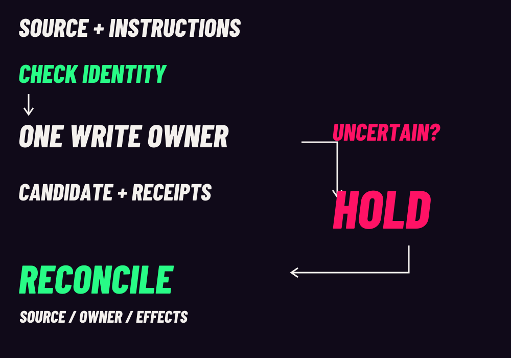

<a href="../README.md">CAPRI</a> · <a href="README_STATIC.md">Static edition</a> · <a href="AFTERIMAGE.md">Afterimage</a> · <a href="STATUS.md">Status</a>

# Field notes

Choose the next thing you need to understand. These paths lead to the existing implementation documents; they do not create another setup guide or imply completed qualification.

  
  
  
  
  

| Reading path | Open the existing documents |
| :--- | :--- |
| Setup | [Offline checks and diagnostics](QUICKSTART.md) · [Host prerequisites](../ENVIRONMENT.md) · [Native startup](../IMPLEMENTATION_README.md#native-startup) |
| Architecture | [Boundaries and handoffs](../ARCHITECTURE.md) · [Security](../SECURITY.md) · [Client support](../CLIENT_SUPPORT.md) |
| Ownership | [Context and native profile](../NATIVE_PROFILE.md) · [Explicit continuation](../IMPLEMENTATION_README.md#explicit-native-continuation) |
| Recovery | [Maintenance and checkpoints](../IMPLEMENTATION_README.md#source-bound-native-maintenance) · [Rollback and legacy route](../IMPLEMENTATION_README.md#rollback-and-legacy-route) |
| Evaluation | [Evidence and limits](../EVALUATION.md) · [Development status](STATUS.md) · [Contributing](../CONTRIBUTING.md) |

## One write owner; uncertainty holds

<picture>
  <source media="(max-width: 600px)" srcset="../showcase/capri/afterimage/ownership-mobile.svg">
  
</picture>

Source and instruction identity are admission conditions. One owner controls writes; checkpoints and receipts bind work to its inputs. If effects are uncertain, the work holds while source, ownership and process/effect evidence are reconciled. Reconciliation does not itself resume a thread or grant a new write owner. Supported recovery needs its own exact binding and checks. See [architecture](../ARCHITECTURE.md) and [the maintenance contract](../IMPLEMENTATION_README.md#source-bound-native-maintenance).

The workflow remains **Thinker → Doer → Reviewer → Thinker report → human decision**, with the hold/reconciliation branch. [Role map](../README.md#the-loop).

<strong>Reading context and recovery claims</strong>

Recent-request footprint, cumulative usage and exact context occupancy are different. Exact occupancy remains **UNKNOWN** when the source cannot establish it. A checkpoint is not a fresh usage budget. Inspect the [profile](../NATIVE_PROFILE.md) and [evaluation](../EVALUATION.md) before drawing a performance or reliability conclusion.

> [!IMPORTANT]
> **Experimental.** Current-source native qualification and final independent review remain pending. Existing CI fails its isolation prerequisite and skips the runtime suite. This navigation artwork is not evidence of a successful run. [Current limits](STATUS.md).

[Implementation guide](../IMPLEMENTATION_README.md) · [Art and motion](AFTERIMAGE.md) · [Credits and build instructions](ASSETS.md)

[Capri explains CAPRI](CAPRI_EXPLAINS.md) — six lessons, native transcript, worked correction and evidence limits.

[Context budget](CONTEXT_BUDGET.md) — editable worked numbers and cache sensitivity. [Transparent actor](CAPRI_ACTOR.md) — alpha masters, provenance and actual cadence.
