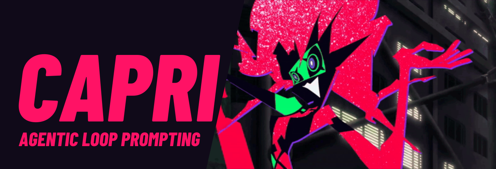
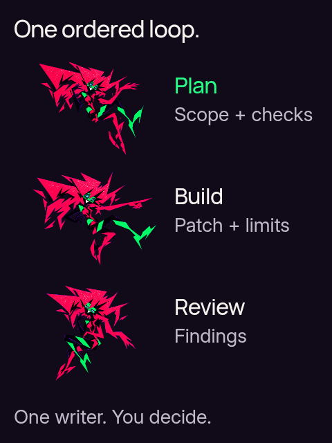
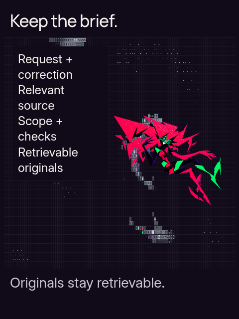
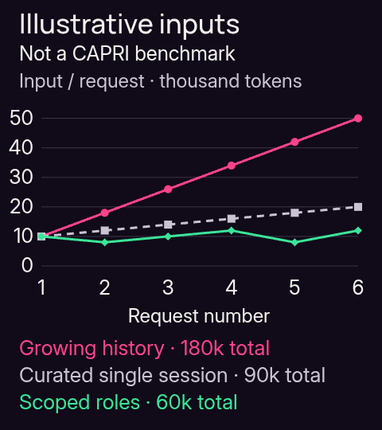
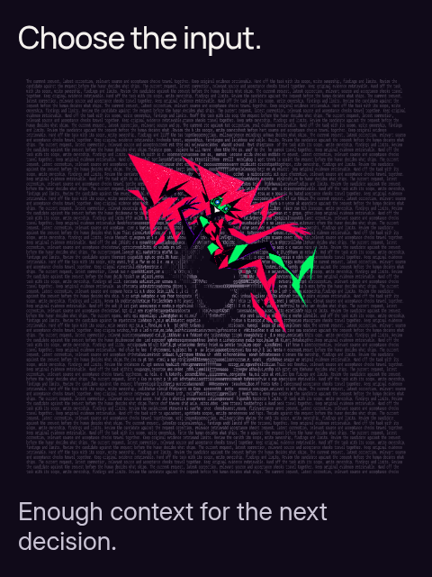
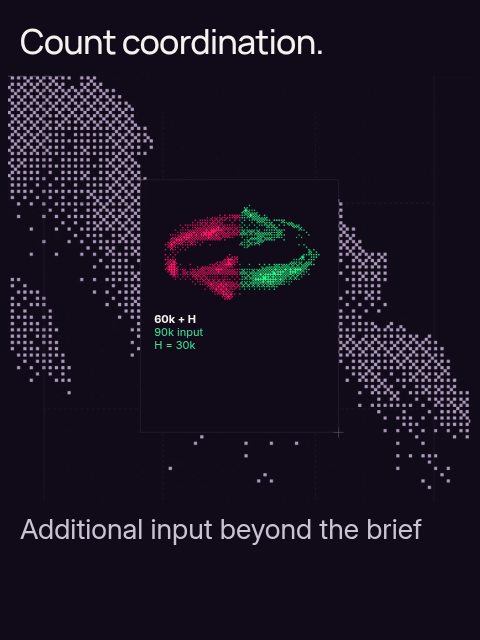
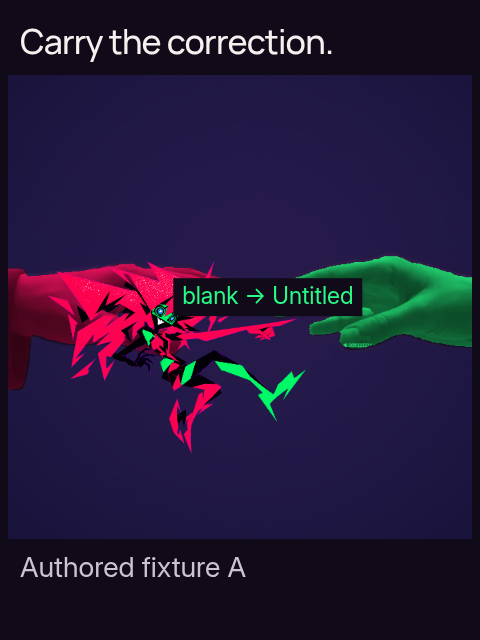
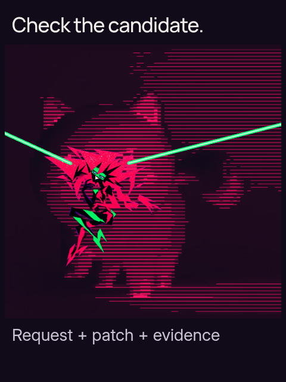
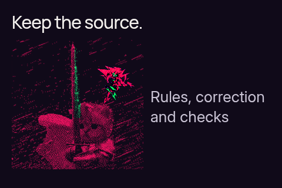
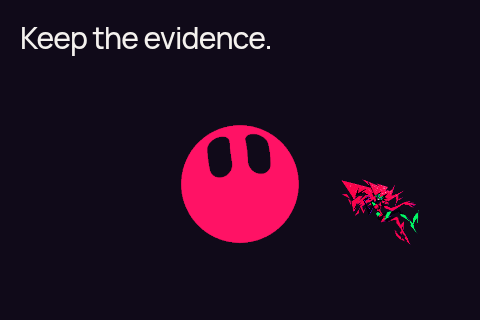

<!-- Generated from the same compact V5 source/data. -->
<picture><source media="(prefers-reduced-motion: reduce)" srcset="../showcase/capri/hero.png"></picture>

CAPRI gives planning, coding and review their own Codex sessions. Explicit handoffs carry current decisions, relevant files, scope and checks. One worker edits; a separate reviewer checks the candidate against the request and evidence. **You decide what ships.**

**Experimental.** Offline checks cover implementation contracts; native launch/recovery qualification remains pending. [Setup](#quickstart) · [Architecture](../ARCHITECTURE.md) · [Current status](../docs/STATUS.md) · [Evaluation](../EVALUATION.md).

<a id="the-loop"></a>

## How the loop works

<p align="center"><picture><source media="(prefers-reduced-motion: reduce)" srcset="../showcase/capri/story/exports/workflow-portrait.png"></picture></p>

<p align="center"><picture><source media="(prefers-reduced-motion: reduce)" srcset="../showcase/capri/story/exports/brief-portrait.png"></picture></p>

A scoped brief carries the request, latest correction, relevant source, allowed files and expected checks. Authoritative originals remain retrievable.

1. **Thinker / Plan:** request + correction + source → scope and acceptance checks.
2. **Doer / Build:** brief + allowed files → patch, check results and limits.
3. **Reviewer / Review:** request + candidate + evidence → findings.
4. **Thinker report → you:** reconcile findings and decide. **One writer; ordered stages.** Uncertain effects hold.

<details>
<summary>Models, ownership and frozen handoffs</summary>

All three roles request `gpt-6.1-sol`. The selected profile uses medium Thinker/Doer effort and high Reviewer effort. Contracts, checkpoints and source checks bind handoffs to their inputs. Formal outcomes stop at `AWAITING_HUMAN`; no successor starts automatically. Separate contexts can share model blind spots.

[Native profile](../NATIVE_PROFILE.md) · [Architecture](../ARCHITECTURE.md) · [Qualification](../docs/STATUS.md)

</details>

<p align="center"></p>

<a id="context-and-evidence"></a>

## Why scope the input

<p align="center"><picture><source media="(prefers-reduced-motion: reduce)" srcset="../showcase/capri/story/exports/graph-graph.png"></picture></p>

**Illustrative inputs — not a CAPRI benchmark.** Across six assumed requests: growing history **180k**, a curated single session **90k**, scoped roles **60k** including already-budgeted instructions and handoffs.

- Growing: `6 × 10k + 8k × (0+1+2+3+4+5) = 180k`.
- Curated: `6 × 10k + 2k × 15 = 90k`.
- `(180−60)/180 = 66.7%` and `(90−60)/90 = 33.3%` are **hypothetical lower input**, not demonstrated cost, speed, quality or retention gains.

Equal work, sufficient information and equal quality remain untested. The 180k total spans calls; it is not one simultaneously occupied context window. Exact active occupancy remains **UNKNOWN**. A carefully curated single session can match or beat scoped input.

<details>
<summary>Every assumed input — tokens per request</summary>

| Request | Growing history | Curated single session | Scoped roles |
| ---: | ---: | ---: | ---: |
| 1 | 10,000 | 10,000 | 10,000 |
| 2 | 18,000 | 12,000 | 8,000 |
| 3 | 26,000 | 14,000 | 10,000 |
| 4 | 34,000 | 16,000 | 12,000 |
| 5 | 42,000 | 18,000 | 8,000 |
| 6 | 50,000 | 20,000 | 12,000 |
| **Total** | **180,000** | **90,000** | **60,000** |

[Canonical assumptions](../showcase/capri/source-match/source/assets/data/context-budget.json) · [Full arithmetic and cache counterexample](../docs/CONTEXT_BUDGET.md) · [Unrun comparisons](../docs/BENCHMARK_PROTOCOL.md)

</details>

<p align="center"><picture><source media="(prefers-reduced-motion: reduce)" srcset="../showcase/capri/story/exports/horizon-portrait.png"></picture></p>

<p align="center"><picture><source media="(prefers-reduced-motion: reduce)" srcset="../showcase/capri/story/exports/coordination-portrait.png"></picture></p>

Focused input can avoid replaying discarded exploration; it still needs enough information. Extra coordination must earn its cost: **60k + H** adds input beyond the handoffs already counted. At **H = 30k**, scoped and curated input are equal; the margin is **30k − H**. Do not count a handoff twice.

<details>
<summary>Additional-input sensitivity and accounting limits</summary>

| Additional H | Scoped input | Relation to curated 90k |
| ---: | ---: | :--- |
| 0k | 60k | 33.3% lower assumed input |
| 15k | 75k | 16.7% lower assumed input |
| 30k | 90k | equal assumed input |
| 45k | 105k | 16.7% higher assumed input |

A short, clear task often fits one ordinary session. Prefix caching reuses matching computation; it does not delete instructions or free context capacity. Fewer raw inputs do not establish price order. Actual accounting needs disjoint ordinary-input, cached-read, cache-write and output buckets, applicable tiers and every role/probe/retry/compaction/recovery attempt. [Accounting assumptions](../docs/CONTEXT_BUDGET.md) · [Measurement protocol](../docs/BENCHMARK_PROTOCOL.md).

</details>

## What a handoff must retain

<p align="center"><picture><source media="(prefers-reduced-motion: reduce)" srcset="../showcase/capri/story/exports/handoff-portrait.png"></picture></p>

<p align="center"><picture><source media="(prefers-reduced-motion: reduce)" srcset="../showcase/capri/story/exports/checking-portrait.png"></picture></p>

**Authored fixture A, not a recorded model result.** The latest correction changes blank input from `Anonymous` to `Untitled`. An incomplete summary can lose compatible rules; review rereads the [original request](../evaluation/fixtures/A/INITIAL.md) and [correction](../evaluation/fixtures/A/CORRECTION.md).

| Rule or check | Required result |
| :--- | :--- |
| `"   "` | `"Untitled"` |
| `"  MiX  Case  "` | `"MiX  Case"`: trim outer whitespace, preserve case/internal spaces |
| `None` | raises `TypeError`: non-strings are rejected |
| Allowed changes | only `label.py` |

The checking context compares request, correction, patch and evidence. Findings and limits return to the human. Shared model blind spots remain; neither the illustration nor offline CI proves CAPRI cheaper, faster or better at retaining requirements.

<p align="center"></p>

<a id="quickstart"></a>

## Start with offline checks

<p align="center"><picture><source media="(prefers-reduced-motion: reduce)" srcset="../showcase/capri/story/exports/requirements-support.png"></picture></p>

<p align="center"><picture><source media="(prefers-reduced-motion: reduce)" srcset="../showcase/capri/story/exports/closing-support.png"></picture></p>

Keep original requirements and evidence accessible; full source interactions remain in the companion.

Start with offline inspection from your checkout. Linux x86_64, Python 3.11+ with pip/venv, bubblewrap and working user, mount, PID and network namespaces are required.

```sh
python3 -m venv .venv
. .venv/bin/activate
python -m pip install --require-hashes -r requirements.lock
PYTHONDONTWRITEBYTECODE=1 python -m unittest discover -s controller/tests -v
```

These tests use disposable fixtures and do not call models or require authentication. A failed isolation prerequisite remains a failure.

[Full setup and diagnostics](../docs/QUICKSTART.md) · [Host requirements](../ENVIRONMENT.md)

<details>
<summary><strong>Before launching native sessions</strong></summary>

Native use additionally requires the qualified Codex CLI 0.163.0/profile, existing local authentication and tmux for ordinary panes. Start from the [preserved implementation guide](../IMPLEMENTATION_README.md#native-startup) and an explicitly registered disposable fixture. Later client versions are not implicitly qualified.

[Compatibility](../CLIENT_SUPPORT.md) · [Example configuration](../examples/config.json)

</details>


## Explore the working source

[Interactive companion](../docs/VISUAL_STORY.md#local-companion) · [Single-column static edition](../docs/README_STATIC.md) · [Detailed explanation](../docs/CAPRI_EXPLAINS.md) · [Art studies](../docs/AFTERIMAGE.md) · [Sources and rights](../docs/SOURCE_MATCH.md#sources-and-rights)

GitHub displays media and native links/disclosures. The local companion supplies real request/H selection, play/pause/replay/seek and source interactions. The graph is a separate readable figure; source art remains animated.

[Architecture](../ARCHITECTURE.md) · [Implementation guide](../IMPLEMENTATION_README.md) · [Benchmark protocol](../docs/BENCHMARK_PROTOCOL.md) · [Status](../docs/STATUS.md) · [Presentation build](../docs/VISUAL_STORY.md) · [Contributing](../CONTRIBUTING.md)

**Mani Marami Milani.** Unofficial Capri-inspired fan project; unaffiliated with CD PROJEKT RED, TRIGGER or Netflix. Original credits and MIT/OFL notices remain. Native sharks/horizon use supplied source implementations; the five other effects are credited footage composites. Character acting is a fan-art reconstruction. Underlying character/media rights remain as recorded; keep private.
