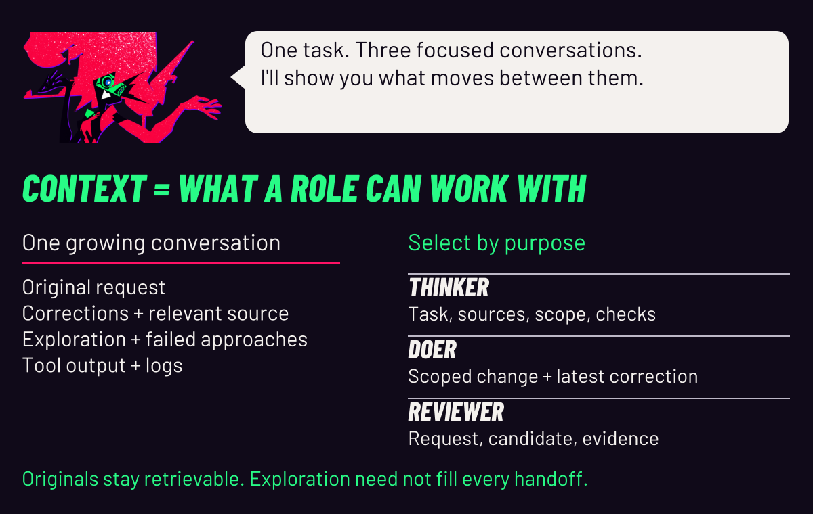
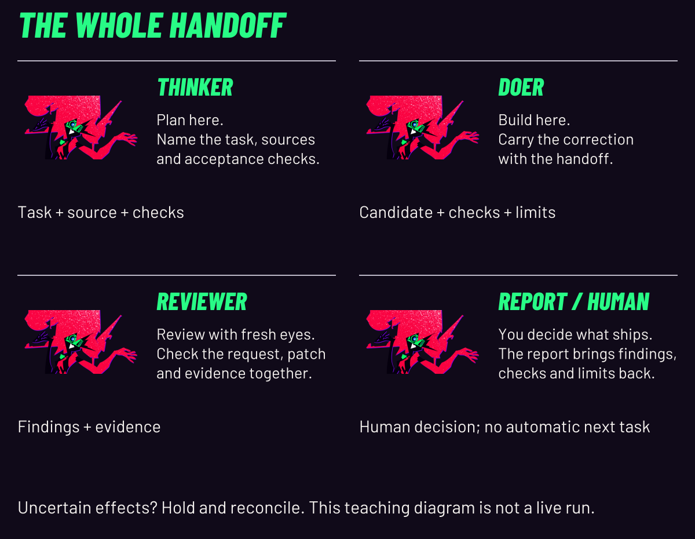

# CAPRI — complete static edition

Every lesson is available without animation. [Animated README](../README.md).


**Give the plan, the patch and the review their own context.**

CAPRI coordinates three Codex sessions: one to research and scope, one to build a candidate, and one to review it against the request. Explicit handoffs carry the decisions forward. You decide what ships.

<p align="center">
  <a href="#quickstart"></a>
  <a href="#the-loop"></a>
  <a href="../docs/AFTERIMAGE.md"></a>
  <a href="#field-notes"></a>
</p>

<p align="center"><a href="../docs/README_STATIC.md">Static edition</a> · <a href="../docs/STATUS.md">Development status</a> · <a href="../docs/ASSETS.md">Art credits</a></p>

<picture>
  <source media="(max-width: 600px)" srcset="../showcase/capri/explainer/context-mobile.svg">
  
</picture>

A **context** is the information a role can work with: instructions, source, conversation history and tool results. Separate contexts let each role focus on its purpose. Useful handoffs retain the original request, latest corrections, relevant source, constraints and checks; exploratory bulk need not fill every recipient's conversation. [Why select context?](../docs/CAPRI_EXPLAINS.md#why-select-context)

<a id="the-loop"></a>

## Follow the handoff

<picture>
  <source media="(max-width: 600px)" srcset="../showcase/capri/explainer/comic-mobile.svg">
  
</picture>

[Complete static edition](../docs/README_STATIC.md) · [All six lessons and native transcript](../docs/CAPRI_EXPLAINS.md) · [What is proven here?](../docs/CAPRI_EXPLAINS.md#what-is-proven-here)

1. **Thinker → Doer:** the scoped task, original request and corrections, source identity, acceptance checks and open questions.
2. **Doer → Reviewer:** the candidate, checks and known limits, together with the request and constraints. A fresh review context helps separate building from checking; using the same model can still share blind spots.
3. **Reviewer → Thinker → you:** findings and evidence become a report. Current CAPRI stages are ordered with **one write owner**. Separate sessions do not mean simultaneous editing. Uncertain effects hold for reconciliation. [Implementation boundaries](../ARCHITECTURE.md).

<details>
<summary><strong>Read all four beats in one still</strong></summary>

<picture>
  <source media="(max-width: 600px)" srcset="../showcase/capri/explainer/comic-mobile.svg">
  
</picture>

The numbered transcript above conveys every stage without waiting for motion. The [full lesson](../docs/CAPRI_EXPLAINS.md) explains the inner tool loop and review limits too. GitHub has no custom playback controls here; the static edition embeds no animated media.

</details>

## A correction that must travel

**Illustration from fixture A — expected behavior, not a completed live run.** The first request says `label(text)` trims outer whitespace, preserves case and internal spaces, rejects non-strings, and uses `Anonymous` for blank text. The latest correction changes the blank label to **`Untitled`**; compatible earlier rules remain. Only `label.py` may change. [Original request](../evaluation/fixtures/A/INITIAL.md) · [Correction](../evaluation/fixtures/A/CORRECTION.md).

| Input | Expected check after the correction |
| :--- | :--- |
| `"   "` | `"Untitled"` |
| `"  MiX  Case  "` | `"MiX  Case"` |
| `None` | raises `TypeError` |

The Doer's packet carries the correction with the original rules. The Reviewer checks both against the candidate and evidence. A summary saying only “implement a label function” loses the decision that matters. [Walk through the packet](../docs/CAPRI_EXPLAINS.md#3-carry-decisions-with-the-packet).

## When is the extra coordination worth it?

Research-heavy work, evolving requirements and changes with checkable outcomes can benefit from focused roles and explicit handoffs. That is the hypothesis behind CAPRI, **not a measured speed or cost advantage**. Coordination itself takes tokens and time. One well-structured session can suit a small, clear task. Broader research finds outcomes depend on task structure and coordination design; it does not benchmark this project. [Research and limits](../docs/CAPRI_EXPLAINS.md#when-to-try-it).

**Experimental:** original evaluation: **8 scheduled, 2 started, 1 graded, 1 aborted, 6 unrun**. The graded row passed 8/8 held-out checks. Repaired-source comparison: **8 scheduled, 0 started, 8 unrun**. Native qualification and independent final review remain pending at the recorded cutoff. The approved-main CI isolation check failed and the runtime suite was skipped. [What is proven here?](../docs/CAPRI_EXPLAINS.md#what-is-proven-here) · [Evaluation](../EVALUATION.md) · [Status](../docs/STATUS.md).

<a id="quickstart"></a>
<h2>
<picture>
  <source media="(prefers-color-scheme: dark)" srcset="../showcase/capri/identity/chapter-start-dark.svg">
  
</picture>
</h2>

Start with offline inspection from your checkout. Linux x86_64, Python 3.11+ with pip/venv, bubblewrap and working user, mount, PID and network namespaces are required.

```sh
python3 -m venv .venv
. .venv/bin/activate
python -m pip install --require-hashes -r requirements.lock
PYTHONDONTWRITEBYTECODE=1 python -m unittest discover -s controller/tests -v
```

These tests use disposable fixtures and do not call models or require authentication. A failed isolation prerequisite remains a failure.

[Full setup and diagnostics](../docs/QUICKSTART.md) · [Host requirements](../ENVIRONMENT.md)

<details>
<summary><strong>Before launching native sessions</strong></summary>

Native use additionally requires the qualified Codex CLI 0.163.0/profile, existing local authentication and tmux for ordinary panes. Start from the [preserved implementation guide](../IMPLEMENTATION_README.md#native-startup) and an explicitly registered disposable fixture. Later client versions are not implicitly qualified.

[Compatibility](../CLIENT_SUPPORT.md) · [Example configuration](../examples/config.json)

</details>

<a href="../docs/AFTERIMAGE.md"></a>

[Enter Afterimage](../docs/AFTERIMAGE.md) — new expression, hand and movement compositions, one motion interlude, and the retained triptych and poster. [Still art edition](../docs/AFTERIMAGE_STATIC.md).

<a id="field-notes"></a>
<h2>
<picture>
  <source media="(prefers-color-scheme: dark)" srcset="../showcase/capri/identity/chapter-notes-dark.svg">
  
</picture>
</h2>

| Open the file | What is inside |
| :--- | :--- |
| [Architecture](../ARCHITECTURE.md) | Ownership, confinement, handoffs and recovery |
| [Implementation guide](../IMPLEMENTATION_README.md) | Existing commands and the native startup path |
| [Evaluation](../EVALUATION.md) | Trial definitions, evidence and comparison limits |
| [Development status](../docs/STATUS.md) | What has and has not been qualified |
| [Contributing](../CONTRIBUTING.md) | How to work on the project |
| [Security](../SECURITY.md) | Boundaries and reporting |

<a href="../docs/README.md"></a>

[Browse the documentation by task](../docs/README.md), with a responsive ownership and reconciliation map.

> [!IMPORTANT]
> **Experimental.** Native lifecycle/recovery qualification, the separate repaired-source comparison and final independent review remain pending at the recorded source cutoff. The current CI isolation prerequisite is failing; the runtime suite was skipped. See [current status](../docs/STATUS.md).

No source-bound product demo was available. Character animation is artwork, not a controller recording.

**Mani Marami Milani** · [Afterimage](../docs/AFTERIMAGE.md) · [Sources and edits](../docs/ASSETS.md) · [Presentation references](../docs/DESIGN_REFERENCES.md)

Unofficial Capri-inspired fan project; unaffiliated with CD PROJEKT RED, TRIGGER or Netflix. Code licensing and public character-art redistribution remain unresolved.[^art]

[^art]: The hero uses BluRei's source 19; the expression footage uses emdzejus's source 12. Barlow Condensed is bundled under its OFL notice. Uploader attribution does not establish underlying anime-image ownership. [Full asset record](../docs/ASSETS.md).
